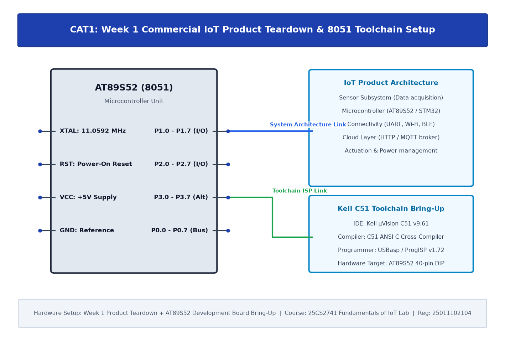

# EXPERIMENT DETAILS

| Field | Details |
|---|---|
| **EXP** | CONTINUOUS LAB EVALUATION-1 |
| **DATE** | 13/07/2026 (Week 1) |
| **NAME OF EXP** | 8051 Development Board Tool Chain Setup & Commercial IoT Product Teardown |
| **HARDWARE SETUP / PLATFORM** | 8051 Microcontroller (AT89S52) + Keil µVision C51 + USBasp Programmer |
| **TASK NO** | Task 1: Product Teardown & Toolchain Bring-Up |

---

## 1. Overview & Objectives

1. **Commercial IoT Product Teardown**: Analysis of commercial smart IoT products (smart plug / smart bulb) dissecting the core four layers:
   - Sensing Layer (temperature, power monitoring, ambient sensing)
   - Compute Engine (8-bit / 32-bit microcontroller unit)
   - Connectivity (Wi-Fi, Bluetooth Low Energy, Zigbee)
   - Cloud / App Platform (MQTT broker, REST API, mobile dashboard)
2. **8051 Toolchain Setup**: Complete installation and verification of the Keil µVision C51 IDE, cross-compiler toolchain, and USBasp device drivers for the AT89S52 development board.

---

## 2. System Architecture & Setup

---

## 3. Core Logic & Toolchain Verification

The toolchain was validated using a baseline bare-metal firmware targeting the AT89S52 microcontroller.

`c
#include <reg51.h>

sbit LED = P1^0;

void delay(void) {
    unsigned int i, j;
    for (i = 0; i < 100; i++)
        for (j = 0; j < 100; j++);
}

void main(void) {
    while (1) {
        LED = 1;
        delay();
        LED = 0;
        delay();
    }
}
`

---

## 4. Inference

The Keil µVision C51 toolchain was successfully installed, configured, and tested. The build environment outputs verified .hex firmware compatible with the USBasp programmer and ProgISP flashing software.
