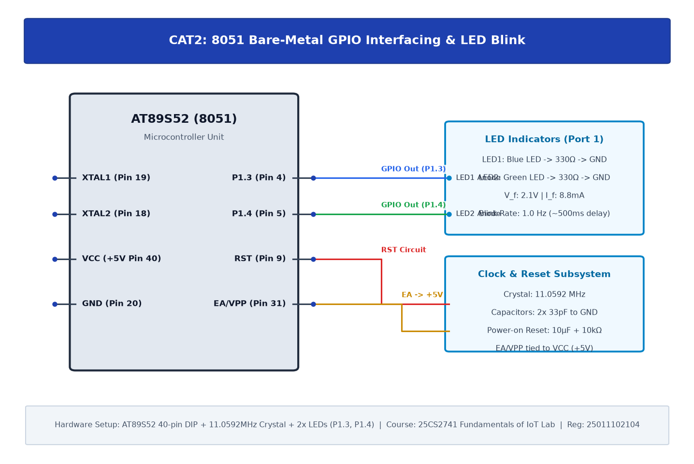

# CAT2: 8051 Development Board Tool Chain Setup & GPIO Interfacing

## 1. Experiment Overview

| Field | Details |
|---|---|
| **Experiment Identifier** | CAT2 |
| **Date of Execution** | 20/07/2026 |
| **Hardware Platform** | 8051 (AT89S52) |
| **Curriculum Scope** | Bare-metal GPIO register-level control, compiler toolchain setup, and LED blinking. |

---

## 2. Hardware Circuit Diagram

---

## 3. Subtask Directory Index

| Task ID | Folder Link | Description & Objective |
|---|---|---|
| **TASK2B** | [TASK2B](TASK2B/) | Interfacing LEDs with 8051 (Blinking & Alternating Output) |

---

## 4. Platform Specifications & Architecture

- **Microcontroller**: 8051 (AT89S52)
- **Development Toolchain**: Keil C51 / Keil MDK-ARM with STM32CubeMX HAL Driver Layer.
- **Verification**: Complete source code, Keil project configurations, compiled `.hex` binaries, and circuit schematics are organized within each subtask directory.
