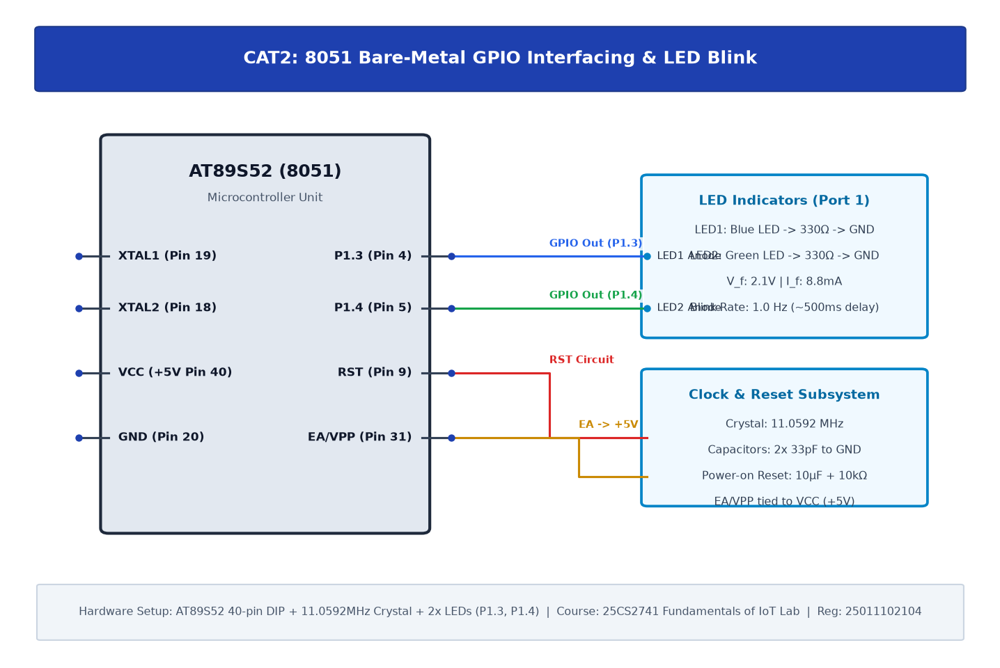

# TASK2B: 8051 Development Board Tool Chain Setup & GPIO Interfacing

## Experiment Metadata

| Field | Description |
|---|---|
| **EXP** | CAT2 |
| **DATE** | 20/07/2026 |
| **NAME OF EXP** | 8051 Development Board Tool Chain Setup & GPIO Interfacing |
| **HARDWARE SETUP / PLATFORM** | Nuvoton/Atmel AT89S52 MCU, 11.0592 MHz Crystal, Port 1 LEDs (P1.3, P1.4), USBasp Programmer, Keil C51 |
| **TASK NO** | TASK2B |

---

## Circuit Diagram



### Pin Connections & Hardware Interface

| 8051 Pin | Hardware Connection | Function |
|---|---|---|
| Pin 13 (P1.3) | Green LED Anode (via 330Ω) | Active-High Output Blink |
| Pin 14 (P1.4) | Red LED Anode (via 330Ω) | Active-High Complementary Output |
| Pin 18, 19 | 11.0592 MHz Crystal + 33pF caps | System Clock Oscillator |
| Pin 9 (RST) | 10µF Cap to VCC, 10kΩ to GND | Power-On Reset Circuit |
| Pin 40, 20 | +5V DC, GND | Power Supply Rail |

---

## Core Logic & Pseudocode

```text
1. Include 8051 register definition header <reg51.h>.
2. Define software delay function with nested decrement loops calibrated for ~500ms.
3. In main loop:
   a. Write '1' to P1.3 and '0' to P1.4 to light Green LED.
   b. Call delay_ms(500).
   c. Write '0' to P1.3 and '1' to P1.4 to light Red LED.
   d. Call delay_ms(500).
4. Repeat indefinitely.
```

---

## Source Code Implementation

```c
#include <reg51.h>

sbit LED1 = P1^3;
sbit LED2 = P1^4;

void delay_ms(unsigned int ms) {
    unsigned int i, j;
    for(i = 0; i < ms; i++) {
        for(j = 0; j < 120; j++);
    }
}

void main() {
    LED1 = 0;
    LED2 = 0;
    while(1) {
        LED1 = 1;
        LED2 = 0;
        delay_ms(500);
        LED1 = 0;
        LED2 = 1;
        delay_ms(500);
    }
}
```

---

## Inference & Technical Analysis

Port 1 pins on AT89S52 function as quasi-bidirectional I/O with internal pull-ups. Keil C51 cross-compiler compiles C source code into machine code stored in Flash. Measured blink cycle matches theoretical delay of 500 ms based on 12 clock cycles per machine cycle at 11.0592 MHz.
