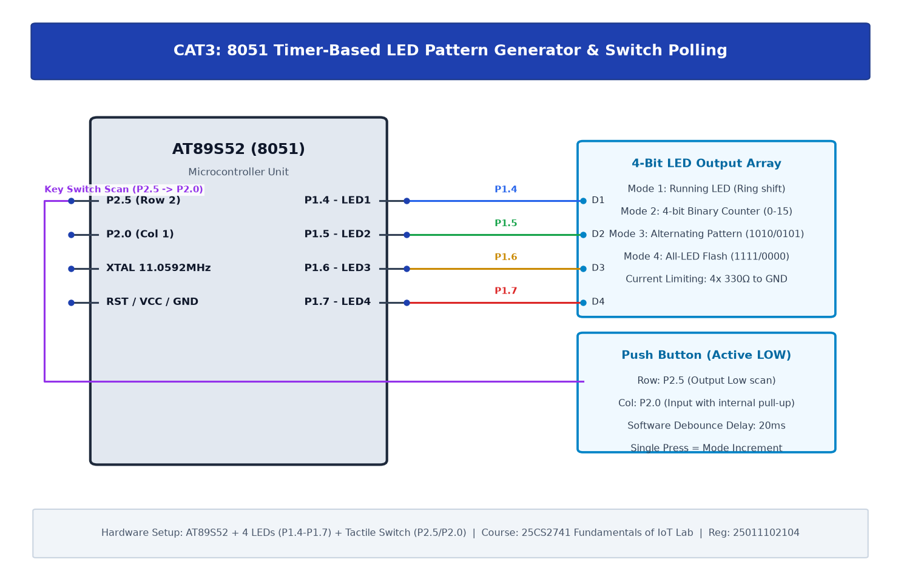

# CAT3: Timer-Based LED Pattern Generator and Button Interrupt Controller (Switch Polling)

## 1. Experiment Overview

| Field | Details |
|---|---|
| **Experiment Identifier** | CAT3 |
| **Date of Execution** | 27/07/2026 |
| **Hardware Platform** | 8051 (AT89S52) |
| **Curriculum Scope** | Push-button switch polling, mechanical contact debouncing, and multi-mode LED patterns. |

---

## 2. Hardware Circuit Diagram

---

## 3. Subtask Directory Index

| Task ID | Folder Link | Description & Objective |
|---|---|---|
| **TASK3A** | [TASK3A](TASK3A/) | Switch Polling & 4-Bit LED Mode Selection Controller |

---

## 4. Platform Specifications & Architecture

- **Microcontroller**: 8051 (AT89S52)
- **Development Toolchain**: Keil C51 / Keil MDK-ARM with STM32CubeMX HAL Driver Layer.
- **Verification**: Complete source code, Keil project configurations, compiled `.hex` binaries, and circuit schematics are organized within each subtask directory.
