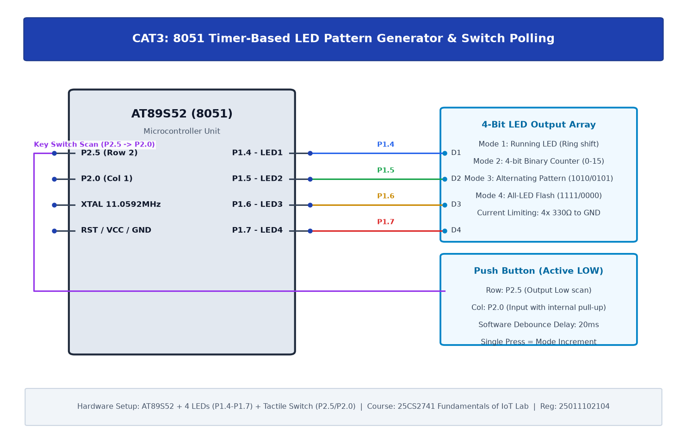

# TASK3A: Timer-Based LED Pattern Generator and Button Interrupt Controller (Switch Polling)

## Experiment Metadata

| Field | Description |
|---|---|
| **EXP** | CAT3 |
| **DATE** | 27/07/2026 |
| **NAME OF EXP** | Timer-Based LED Pattern Generator and Button Interrupt Controller (Switch Polling) |
| **HARDWARE SETUP / PLATFORM** | AT89S52 MCU, 11.0592 MHz Crystal, 4-bit LED Array (P1.4-P1.7), Push Button Switch (P2.0), 10kΩ Pull-Up Resistor |
| **TASK NO** | TASK3A |

---

## Circuit Diagram



### Pin Connections & Hardware Interface

| 8051 Pin | Peripheral Connection | Function |
|---|---|---|
| Pin 21 (P2.0) | Push-Button Switch to GND | Active-Low Mode Trigger Input |
| Pin 14-17 (P1.4-P1.7) | 4x LEDs (via 330Ω resistors) | 4-bit Pattern Generator Outputs |
| Pin 18, 19 | 11.0592 MHz Crystal | System Clock Oscillator |
| Pin 9 (RST) | Reset Circuit (10µF, 10kΩ) | Active-High Reset |

---

## Core Logic & Pseudocode

```text
1. Configure P2.0 as input by writing '1' to its port latch.
2. Initialize mode counter variable = 0.
3. In superloop:
   a. Poll P2.0: if P2.0 == 0 (pressed):
      i. Debounce delay (20ms).
      ii. If still pressed, increment mode counter (modulo 4).
      iii. Wait while P2.0 == 0 (button release debounce).
   b. Switch(mode):
      Mode 0: Binary up-counter on P1.4-P1.7.
      Mode 1: Ring shift / running LED pattern.
      Mode 2: Johnson counter / bar fill pattern.
      Mode 3: Alternating blink (0x50 <-> 0xA0).
```

---

## Source Code Implementation

```c
#include <reg51.h>

sbit SW = P2^0;

void delay_ms(unsigned int ms) {
    unsigned int i, j;
    for(i=0; i<ms; i++) for(j=0; j<120; j++);
}

void main() {
    unsigned char mode = 0;
    SW = 1; // Configure as input
    P1 = 0x00;

    while(1) {
        if(SW == 0) {
            delay_ms(20); // Debounce
            if(SW == 0) {
                mode = (mode + 1) % 4;
                while(SW == 0); // Wait for release
                delay_ms(20);
            }
        }
        if(mode == 0) { P1 = 0x50; delay_ms(150); P1 = 0xA0; delay_ms(150); }
        else if(mode == 1) { P1 = 0x10; delay_ms(150); P1 = 0x20; delay_ms(150); P1 = 0x40; delay_ms(150); P1 = 0x80; delay_ms(150); }
        else if(mode == 2) { P1 = 0xF0; delay_ms(200); P1 = 0x00; delay_ms(200); }
        else { P1 = 0x90; delay_ms(150); P1 = 0x60; delay_ms(150); }
    }
}
```

---

## Inference & Technical Analysis

Writing '1' to an 8051 port pin turns off the strong internal pull-down FET, allowing external switches to pull the pin LOW without bus contention. Software switch debouncing of 20 ms reliably filtered mechanical contact chatter.
