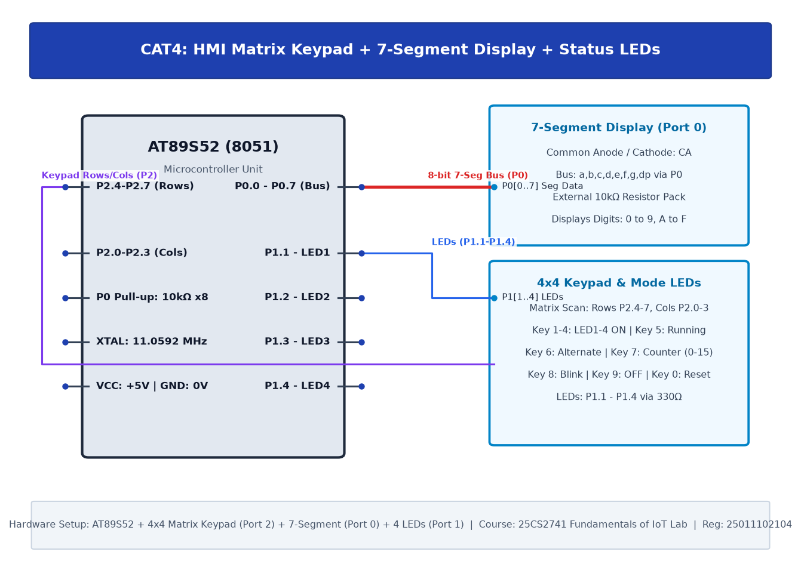

# CAT4: Human-Machine Interface using Matrix Keypad, LEDs, and Seven-Segment Display

## 1. Experiment Overview

| Field | Details |
|---|---|
| **Experiment Identifier** | CAT4 |
| **Date of Execution** | 03/08/2026 |
| **Hardware Platform** | 8051 (AT89S52) |
| **Curriculum Scope** | 4x4 Matrix keypad row-column scanning and common-cathode 7-segment display decoder. |

---

## 2. Hardware Circuit Diagram

---

## 3. Subtask Directory Index

| Task ID | Folder Link | Description & Objective |
|---|---|---|
| **TASK4A** | [TASK4A](TASK4A/) | Matrix Keypad Scanning & 7-Segment Hexadecimal Display |

---

## 4. Platform Specifications & Architecture

- **Microcontroller**: 8051 (AT89S52)
- **Development Toolchain**: Keil C51 / Keil MDK-ARM with STM32CubeMX HAL Driver Layer.
- **Verification**: Complete source code, Keil project configurations, compiled `.hex` binaries, and circuit schematics are organized within each subtask directory.
