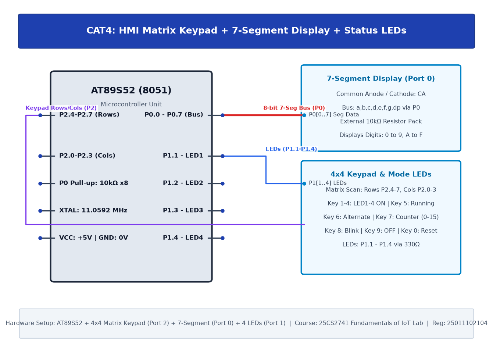

# TASK4A: Human-Machine Interface using Matrix Keypad, LEDs, and Seven-Segment Display

## Experiment Metadata

| Field | Description |
|---|---|
| **EXP** | CAT4 |
| **DATE** | 03/08/2026 |
| **NAME OF EXP** | Human-Machine Interface using Matrix Keypad, LEDs, and Seven-Segment Display |
| **HARDWARE SETUP / PLATFORM** | AT89S52 MCU, 4x4 Matrix Keypad (Port 2), Common Cathode 7-Segment Display (Port 0 with 10kΩ pull-up resistor pack) |
| **TASK NO** | TASK4A |

---

## Circuit Diagram



### Pin Connections & Hardware Interface

| 8051 Port | Peripheral Connection | Function |
|---|---|---|
| P2.0 - P2.3 | Keypad Rows R1-R4 | Active-Low Row Scan Outputs |
| P2.4 - P2.7 | Keypad Columns C1-C4 | Column Read Inputs (with pull-ups) |
| P0.0 - P0.6 | 7-Segment Segments a-g | Segment Cathode Drive Outputs |
| P0.7 (DP) | 7-Segment Decimal Point | Status / Activity Indicator |

---

## Core Logic & Pseudocode

```text
1. Define 7-segment hex lookup table for digits 0-F.
2. Initialize Port 0 as output (with external pull-up pack).
3. Implement keypad scan routine:
   a. Ground Row 0, read Columns. If column low, return corresponding key.
   b. Repeat for Rows 1, 2, 3 sequentially.
4. When key pressed:
   a. Look up segment pattern from lookup table.
   b. Output pattern to Port 0.
   c. Wait for key release.
```

---

## Source Code Implementation

```c
#include <reg51.h>

unsigned char code seg_lut[16] = {
    0x3F, 0x06, 0x5B, 0x4F, 0x66, 0x6D, 0x7D, 0x07,
    0x7F, 0x6F, 0x77, 0x7C, 0x39, 0x5E, 0x79, 0x71
};

void delay_ms(unsigned int ms) {
    unsigned int i, j;
    for(i=0; i<ms; i++) for(j=0; j<120; j++);
}

unsigned char scan_keypad() {
    P2 = 0xFE; if(!(P2 & 0x10)) return 0; if(!(P2 & 0x20)) return 1; if(!(P2 & 0x40)) return 2; if(!(P2 & 0x80)) return 3;
    P2 = 0xFD; if(!(P2 & 0x10)) return 4; if(!(P2 & 0x20)) return 5; if(!(P2 & 0x40)) return 6; if(!(P2 & 0x80)) return 7;
    P2 = 0xFB; if(!(P2 & 0x10)) return 8; if(!(P2 & 0x20)) return 9; if(!(P2 & 0x40)) return 10; if(!(P2 & 0x80)) return 11;
    P2 = 0xF7; if(!(P2 & 0x10)) return 12; if(!(P2 & 0x20)) return 13; if(!(P2 & 0x40)) return 14; if(!(P2 & 0x80)) return 15;
    return 0xFF;
}

void main() {
    unsigned char key;
    P0 = seg_lut[0];
    while(1) {
        key = scan_keypad();
        if(key != 0xFF) {
            P0 = seg_lut[key];
            delay_ms(250);
        }
    }
}
```

---

## Inference & Technical Analysis

Port 0 on 8051 is open-drain when used as standard I/O and strictly requires external pull-up resistors (10 kΩ SIL pack) to output high logic levels. Row-column matrix multiplexing reduced 16 button connections down to 8 microcontroller pins.
