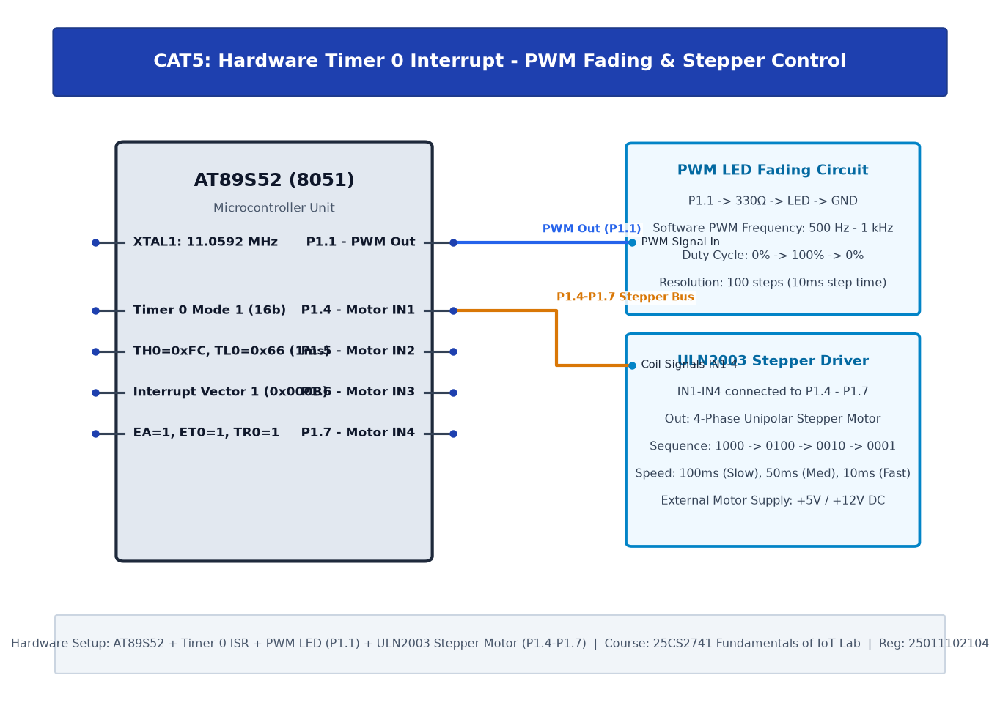

# CAT5: Hardware Timer and Interrupt-Based Timing for LED Fading, Pulse Generation, and Stepper Motor Control

## 1. Experiment Overview

| Field | Details |
|---|---|
| **Experiment Identifier** | CAT5 |
| **Date of Execution** | 10/08/2026 |
| **Hardware Platform** | 8051 (AT89S52) |
| **Curriculum Scope** | 16-bit hardware timer square wave synthesis, software PWM duty cycle dimming, and ULN2003 stepper motor control. |

---

## 2. Hardware Circuit Diagram

---

## 3. Subtask Directory Index

| Task ID | Folder Link | Description & Objective |
|---|---|---|
| **TASK5A** | [TASK5A](TASK5A/) | Hardware Timer 0 Mode 1: 1 kHz Square Wave Synthesis |
| **TASK5B.1** | [TASK5B.1](TASK5B/TASK5B.1/) | Software PWM LED Dimming: 25% Duty Cycle |
| **TASK5B.2** | [TASK5B.2](TASK5B/TASK5B.2/) | Software PWM LED Dimming: 50% Duty Cycle |
| **TASK5B.3** | [TASK5B.3](TASK5B/TASK5B.3/) | Software PWM LED Dimming: 75% Duty Cycle |
| **TASK5C** | [TASK5C](TASK5C/) | 4-Phase Unipolar Stepper Motor Control via ULN2003 Darlington Driver |

---

## 4. Platform Specifications & Architecture

- **Microcontroller**: 8051 (AT89S52)
- **Development Toolchain**: Keil C51 / Keil MDK-ARM with STM32CubeMX HAL Driver Layer.
- **Verification**: Complete source code, Keil project configurations, compiled `.hex` binaries, and circuit schematics are organized within each subtask directory.
