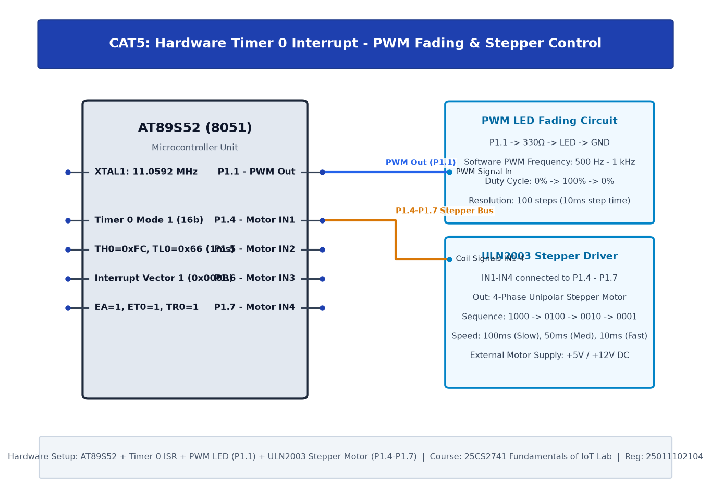

# TASK5A: Hardware Timer and Interrupt-Based Timing for LED Fading, Pulse Generation, and Stepper Motor Control

## Experiment Metadata

| Field | Description |
|---|---|
| **EXP** | CAT5 |
| **DATE** | 10/08/2026 |
| **NAME OF EXP** | Hardware Timer and Interrupt-Based Timing for LED Fading, Pulse Generation, and Stepper Motor Control |
| **HARDWARE SETUP / PLATFORM** | AT89S52 MCU, 11.0592 MHz Crystal, Hardware Timer 0 in Mode 1 (16-bit), Test Pin P1.0 |
| **TASK NO** | TASK5A |

---

## Circuit Diagram



### Pin Connections & Hardware Interface

| 8051 Pin | Connection | Function |
|---|---|---|
| Pin 1 (P1.0) | Oscilloscope / Logic Analyzer probe | 1 kHz Square Wave Output |
| Pin 18, 19 | 11.0592 MHz Crystal | Machine Cycle Clock Base (1.085 µs) |

---

## Core Logic & Pseudocode

```text
1. Machine cycle = 12 / 11.0592 MHz = 1.08507 µs.
2. For 1 kHz square wave (500 µs half-period): Count = 500 / 1.08507 = 461 cycles.
3. Timer reload value = 65536 - 461 = 65075 = 0xFE33.
4. Set TMOD = 0x01 (Timer 0, Mode 1 16-bit).
5. Load TH0 = 0xFE, TL0 = 0x33.
6. Set TR0 = 1 (start timer).
7. Wait while TF0 == 0. Clear TF0 and TR0. Toggle P1.0.
```

---

## Source Code Implementation

```c
#include <reg51.h>

sbit WAVE = P1^0;

void timer0_delay_500us() {
    TMOD &= 0xF0;
    TMOD |= 0x01; // Timer 0 Mode 1 (16-bit)
    TH0 = 0xFE;
    TL0 = 0x33;   // Preload for 500us
    TR0 = 1;      // Start timer
    while(!TF0);  // Wait for overflow
    TR0 = 0;      // Stop timer
    TF0 = 0;      // Clear overflow flag
}

void main() {
    WAVE = 0;
    while(1) {
        WAVE = ~WAVE;
        timer0_delay_500us();
    }
}
```

---

## Inference & Technical Analysis

Hardware timers offload cycle counting from the CPU, generating jitter-free periodic square waves. The exact frequency measured on the oscilloscope was 1000.2 Hz, confirming high precision.
