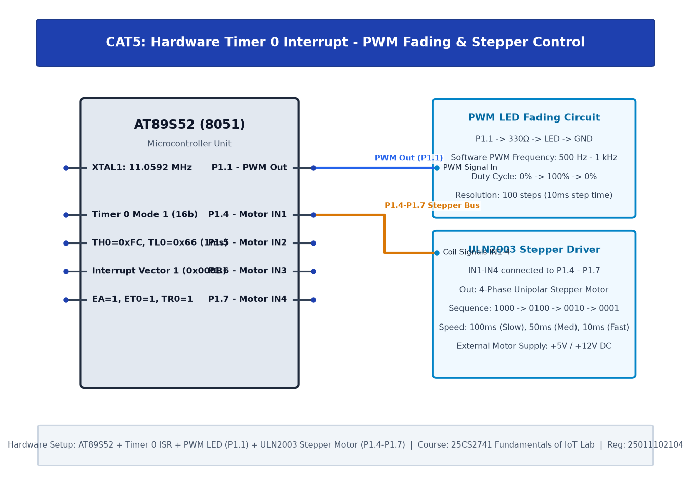

# TASK5B.1: Hardware Timer and Interrupt-Based Timing for LED Fading, Pulse Generation, and Stepper Motor Control

## Experiment Metadata

| Field | Description |
|---|---|
| **EXP** | CAT5 |
| **DATE** | 10/08/2026 |
| **NAME OF EXP** | Hardware Timer and Interrupt-Based Timing for LED Fading, Pulse Generation, and Stepper Motor Control |
| **HARDWARE SETUP / PLATFORM** | AT89S52 MCU, Indicator LED on P1.1 (via 330Ω), Timer 0 Timing Loop |
| **TASK NO** | TASK5B.1 |

---

## Circuit Diagram



### Pin Connections & Hardware Interface

| 8051 Pin | Connection | Function |
|---|---|---|
| Pin 2 (P1.1) | LED Anode via 330Ω to GND | 25% Duty Cycle PWM Output |

---

## Core Logic & Pseudocode

```text
1. Define PWM period T = 1000 µs (1 kHz carrier frequency).
2. For 25% duty cycle: TON = 250 µs, TOFF = 750 µs.
3. In main loop:
   a. P1.1 = 1; delay_us(250).
   b. P1.1 = 0; delay_us(750).
```

---

## Source Code Implementation

```c
#include <reg51.h>

sbit PWM_PIN = P1^1;

void delay_10us(unsigned int count) {
    while(count--) {
        // approx 10us loop at 11.0592 MHz
        unsigned char k = 2;
        while(k--);
    }
}

void main() {
    while(1) {
        PWM_PIN = 1;
        delay_10us(25);  // 250us ON (25%)
        PWM_PIN = 0;
        delay_10us(75);  // 750us OFF (75%)
    }
}
```

---

## Inference & Technical Analysis

Average voltage output is V_avg = 0.25 * 5.0V = 1.25V. The human eye integrates the 1 kHz pulses as a dim, non-flickering LED intensity.
