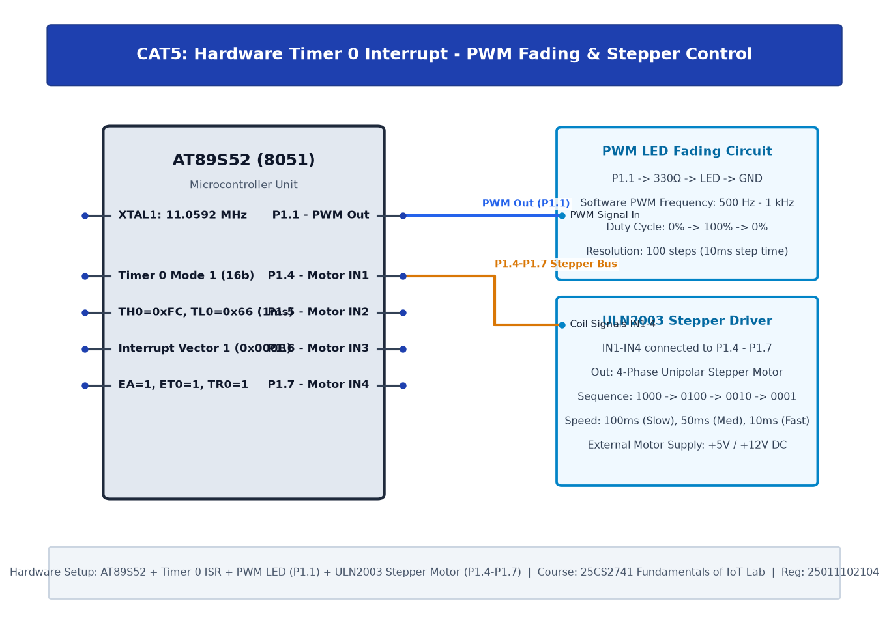

# TASK5C: Hardware Timer and Interrupt-Based Timing for LED Fading, Pulse Generation, and Stepper Motor Control

## Experiment Metadata

| Field | Description |
|---|---|
| **EXP** | CAT5 |
| **DATE** | 10/08/2026 |
| **NAME OF EXP** | Hardware Timer and Interrupt-Based Timing for LED Fading, Pulse Generation, and Stepper Motor Control |
| **HARDWARE SETUP / PLATFORM** | AT89S52 MCU, ULN2003A Darlington Transistor Driver, 28BYJ-48 5V Unipolar Stepper Motor connected to P1.4-P1.7 |
| **TASK NO** | TASK5C |

---

## Circuit Diagram



### Pin Connections & Hardware Interface

| 8051 Port | ULN2003 Pin | Stepper Coil | Function |
|---|---|---|---|
| P1.4 | IN1 -> OUT1 | Blue wire (Coil 1) | Phase A Energize |
| P1.5 | IN2 -> OUT2 | Pink wire (Coil 2) | Phase B Energize |
| P1.6 | IN3 -> OUT3 | Yellow wire (Coil 3) | Phase C Energize |
| P1.7 | IN4 -> OUT4 | Orange wire (Coil 4) | Phase D Energize |
| GND | GND | Red wire (+5V) | Common power connection |

---

## Core Logic & Pseudocode

```text
1. Define 4-step wave drive excitation table: {0x10, 0x20, 0x40, 0x80}.
2. Initialize step index = 0.
3. In main loop:
   a. Output step[index] to Port 1.
   b. Call delay_ms(step_delay) controlling rotational speed.
   c. Increment step index modulo 4 for clockwise rotation.
```

---

## Source Code Implementation

```c
#include <reg51.h>

void delay_ms(unsigned int ms) {
    unsigned int i, j;
    for(i=0; i<ms; i++) for(j=0; j<120; j++);
}

void main() {
    unsigned char step_seq[4] = {0x10, 0x20, 0x40, 0x80};
    unsigned char i;
    while(1) {
        for(i = 0; i < 4; i++) {
            P1 = step_seq[i];
            delay_ms(30); // 30ms step interval
        }
    }
}
```

---

## Inference & Technical Analysis

AT89S52 GPIO pins can sink up to 10-20mA but cannot source inductive motor current. The ULN2003 Darlington driver provides 500mA open-collector drive capability with built-in suppression flyback diodes protecting the MCU from inductive kickback.
