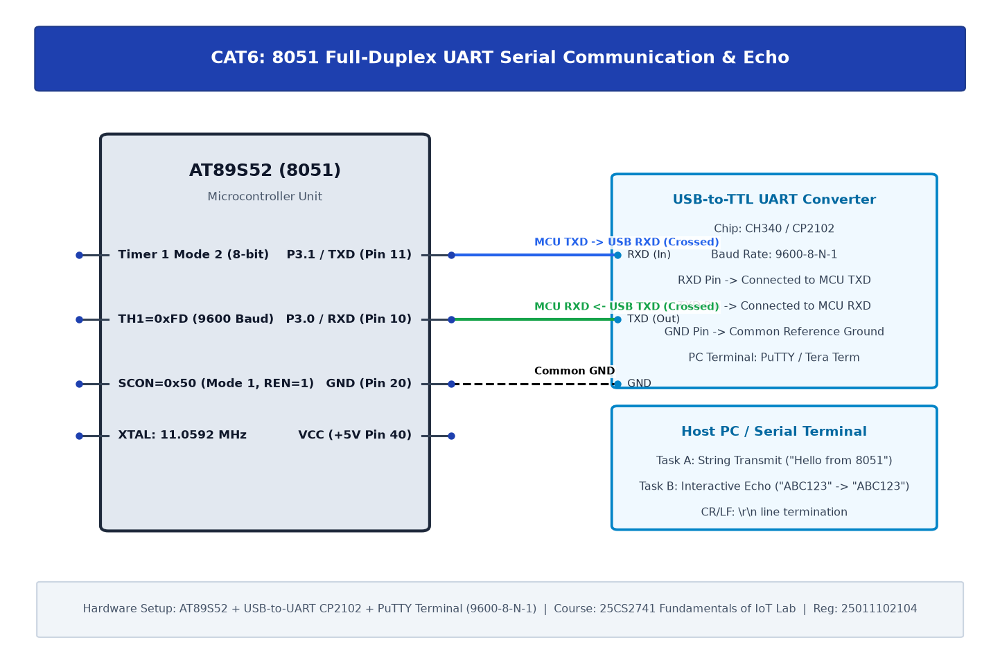

# EXPERIMENT DETAILS

| Field | Details |
|---|---|
| **EXP** | CONTINUOUS LAB EVALUATION-6 |
| **DATE** | 17/08/2026 (Week 6) |
| **NAME OF EXP** | UART Driver and Serial Debugging |
| **HARDWARE SETUP / PLATFORM** | AT89S52 + USB-to-TTL UART Converter (CP2102/CH340) + PuTTY Terminal |
| **TASK NO** | Task A: UART String Transmission & Task B: PuTTY UART Echo |

---

## 1. Problem Statement

Develop an interrupt-capable, full-duplex UART driver for the 8051 microcontroller that communicates with a PC serial terminal through a USB-to-TTL interface. Configure the UART for **9600-8-N-1** asynchronous communication. Implement:
1. **Task A**: Continuous string transmission ("Hello from 8051") to the terminal.
2. **Task B**: Full-duplex interactive UART echo, receiving characters from the PC keyboard and transmitting them back.

---

## 2. Circuit Diagram



### Hardware Connections
- **AT89S52 Pins**:
  - `P3.1 / TXD` (Pin 11): Serial transmit output -> Connected to USB-to-TTL **RXD** pin.
  - `P3.0 / RXD` (Pin 10): Serial receive input <- Connected to USB-to-TTL **TXD** pin.
  - `GND` (Pin 20): Common ground reference tied to USB converter GND.
- **Baud Rate Generation**:
  - Timer 1 configured in **Mode 2** (8-bit auto-reload).
  - Crystal frequency: 11.0592 MHz.
  - Reload formula:
    $$\text{Baud Rate} = \frac{f_{\text{osc}}}{384 \times (256 - \text{TH1})}$$
    $$9600 = \frac{11.0592 \times 10^6}{384 \times (256 - \text{TH1})} \implies 256 - \text{TH1} = 3 \implies \text{TH1} = 253 = \text{0xFD}$$

---

## 3. Core Logic & Source Code

### Register Configurations
- **`SCON = 0x50`**: Mode 1 (8-bit UART, variable baud rate determined by Timer 1), Receiver Enabled (`REN = 1`).
- **`TMOD = 0x20`**: Timer 1 in Mode 2 (8-bit auto-reload).
- **`TH1 = 0xFD`**: Reload value for 9600 baud.
- **`TR1 = 1`**: Start Timer 1.

### Source Code (`uart.c`)
```c
#include <reg51.h>

void main(void) {
    char ch;
    SCON = 0x50;    // Mode 1: 8-bit UART, enable receiver
    TMOD = 0x20;    // Timer 1: Mode 2 (8-bit auto-reload)
    TH1 = 0xFD;     // Baud rate 9600 at 11.0592 MHz
    TR1 = 1;        // Start Timer 1
    
    while (1) {
        while (RI == 0);    // Wait until character is received
        ch = SBUF;          // Read received character from buffer
        RI = 0;             // Clear receive interrupt flag
        
        while (TI == 0);    // Wait until transmit buffer is ready
        SBUF = ch;          // Transmit character back to host PC
        TI = 0;             // Clear transmit interrupt flag
    }
}
```

---

## 4. Inference & Observations

1. **Crystal Frequency Rationale**: The standard 11.0592 MHz crystal produces exact integer divisions for standard serial baud rates (9600, 19200, 28800), resulting in zero baud-rate error ($	ext{Error} = 0.0\%$).
2. **Flag Management**: The hardware sets `RI` when a byte is fully assembled in `SBUF`, and sets `TI` when a byte is completely shifted out. Both flags must be cleared manually in software.
3. **Loopback Echo Verification**: Characters typed in PuTTY (`ABC123`) were received and echoed back without character corruption or framing errors.
