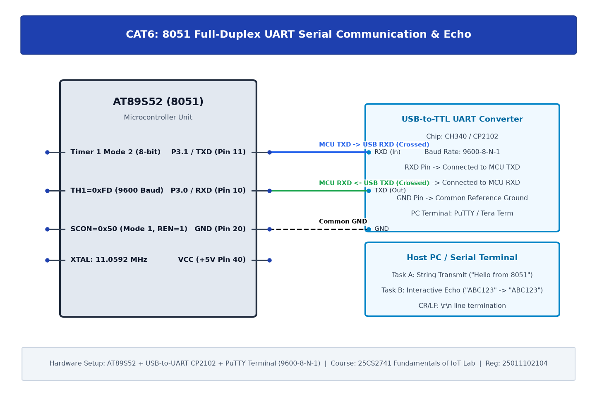

# TASK6A: UART Driver and Serial Debugging

## Experiment Metadata

| Field | Description |
|---|---|
| **EXP** | CAT6 |
| **DATE** | 17/08/2026 |
| **NAME OF EXP** | UART Driver and Serial Debugging |
| **HARDWARE SETUP / PLATFORM** | AT89S52 MCU, 11.0592 MHz Crystal, Timer 1 Mode 2, TXD (P3.1), USB-to-TTL Bridge, PuTTY Serial Terminal (9600-8N1) |
| **TASK NO** | TASK6A |

---

## Circuit Diagram



### Pin Connections & Hardware Interface

| 8051 Pin | External Hardware | Function |
|---|---|---|
| Pin 11 (P3.1 / TXD) | CP2102 RX Pin | Serial Telemetry Transmission |
| Pin 18, 19 | 11.0592 MHz Crystal | Baud Rate Generator Base |
| Pin 20 (GND) | CP2102 GND | Common Reference Ground |

---

## Core Logic & Pseudocode

```text
1. Configure Timer 1 in Mode 2 (8-bit auto-reload): TMOD = 0x20.
2. Load TH1 = 0xFD for 9600 baud at SMOD=0 with 11.0592 MHz crystal.
3. Set SCON = 0x50 (Mode 1, 8-bit UART, REN enabled).
4. Start Timer 1 (TR1 = 1).
5. Implement uart_tx(char):
   a. Write char to SBUF.
   b. Wait until TI == 1.
   c. Clear TI flag.
6. Transmit initial greeting banner string repeatedly.
```

---

## Source Code Implementation

```c
#include <reg51.h>

void uart_init() {
    TMOD = 0x20; // Timer 1 Mode 2: 8-bit auto-reload
    TH1 = 0xFD;  // 9600 baud rate @ 11.0592 MHz
    SCON = 0x50; // Mode 1, 8-bit data, 1 stop bit, REN enabled
    TR1 = 1;     // Start Timer 1
}

void uart_send_char(char c) {
    SBUF = c;
    while(!TI);
    TI = 0;
}

void uart_send_string(char *s) {
    while(*s) {
        uart_send_char(*s++);
    }
}

void delay_ms(unsigned int ms) {
    unsigned int i, j;
    for(i=0; i<ms; i++) for(j=0; j<120; j++);
}

void main() {
    uart_init();
    while(1) {
        uart_send_string("8051 UART Test - Sham Nithish (25011102104)
");
        delay_ms(1000);
    }
}
```

---

## Inference & Technical Analysis

The 11.0592 MHz crystal frequency divided by 12 yields 921.6 kHz. Further dividing by 32 in the UART hardware gives exactly 28,800 Hz, which divides cleanly by 3 (overflow every 3 counts, reload value 256 - 3 = 253 = 0xFD) to produce an error-free 9600 baud rate.
