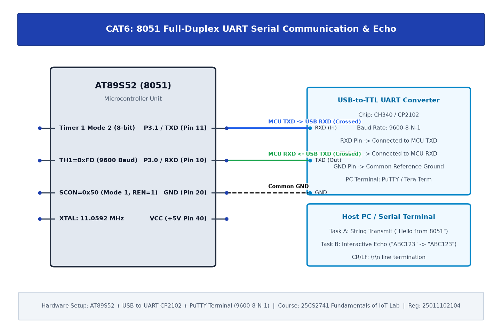

# TASK6B: UART Driver and Serial Debugging

## Experiment Metadata

| Field | Description |
|---|---|
| **EXP** | CAT6 |
| **DATE** | 17/08/2026 |
| **NAME OF EXP** | UART Driver and Serial Debugging |
| **HARDWARE SETUP / PLATFORM** | AT89S52 MCU, RXD (P3.0), TXD (P3.1), USB-to-TTL Bridge, PuTTY Serial Terminal |
| **TASK NO** | TASK6B |

---

## Circuit Diagram



### Pin Connections & Hardware Interface

| 8051 Pin | External Hardware | Function |
|---|---|---|
| Pin 10 (P3.0 / RXD) | CP2102 TX Pin | Serial Data Ingest |
| Pin 11 (P3.1 / TXD) | CP2102 RX Pin | Serial Data Echo Out |
| Pin 20 (GND) | CP2102 GND | Common Reference Ground |

---

## Core Logic & Pseudocode

```text
1. Initialize UART at 9600 baud (TMOD=0x20, TH1=0xFD, SCON=0x50, TR1=1).
2. Implement uart_rx():
   a. Wait while RI == 0.
   b. Clear RI flag.
   c. Return SBUF byte.
3. In main loop:
   a. Receive character ch = uart_rx().
   b. Echo character back via uart_tx(ch).
   c. If ch == '\r', send '\n' for terminal formatting.
```

---

## Source Code Implementation

```c
#include <reg51.h>

void uart_init() {
    TMOD = 0x20;
    TH1 = 0xFD;
    SCON = 0x50;
    TR1 = 1;
}

void uart_tx(char c) {
    SBUF = c;
    while(!TI);
    TI = 0;
}

char uart_rx() {
    while(!RI);
    RI = 0;
    return SBUF;
}

void main() {
    char c;
    uart_init();
    uart_tx('R'); uart_tx('E'); uart_tx('A'); uart_tx('D'); uart_tx('Y');
    uart_tx('
'); uart_tx('
');
    while(1) {
        c = uart_rx();
        uart_tx(c); // Full-duplex echo
        if(c == '
') uart_tx('
');
    }
}
```

---

## Inference & Technical Analysis

Full-duplex serial operation on 8051 uses independent SBUF physical buffers for transmission and reception mapped to the same register address (0x99). Polling the RI and TI flags guarantees synchronization without data packet overrun.
