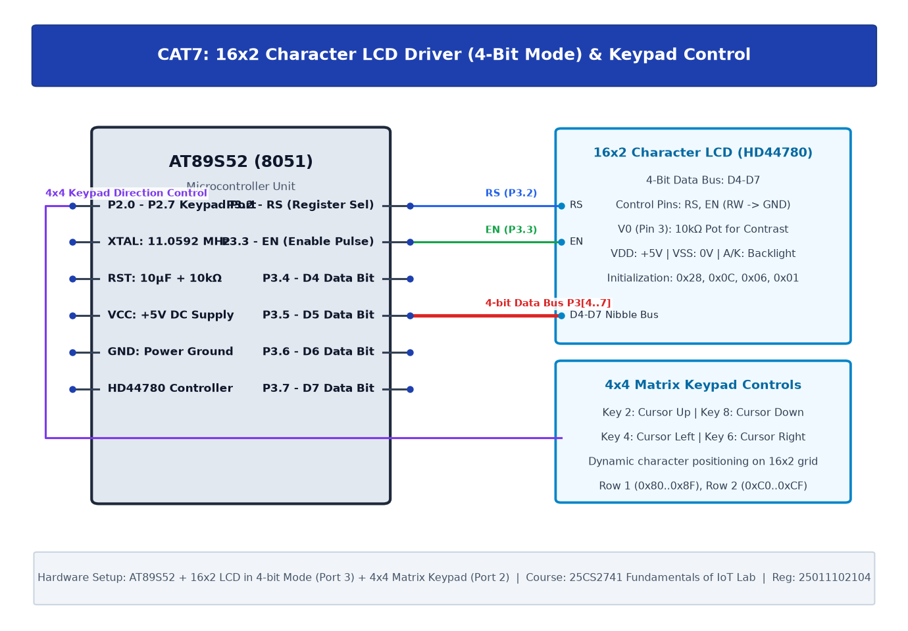

# CAT7: 16x2 LCD Driver Development and Dynamic Display Control

## 1. Experiment Overview

| Field | Details |
|---|---|
| **Experiment Identifier** | CAT7 |
| **Date of Execution** | 24/08/2026 |
| **Hardware Platform** | 8051 (AT89S52) |
| **Curriculum Scope** | HD44780 LCD 4-bit bus interface driver, dynamic marquee scrolling, and keypad integration. |

---

## 2. Hardware Circuit Diagram

---

## 3. Subtask Directory Index

| Task ID | Folder Link | Description & Objective |
|---|---|---|
| **TASK7A** | [TASK7A](TASK7A/) | 16x2 LCD 4-Bit Initialization & Alphanumeric Text Display |
| **TASK7B** | [TASK7B](TASK7B/) | Dynamic Marquee Display Scrolling & Text Rotation |
| **TASK7C** | [TASK7C](TASK7C/) | Interactive Matrix Keypad Entry to 16x2 LCD Display |

---

## 4. Platform Specifications & Architecture

- **Microcontroller**: 8051 (AT89S52)
- **Development Toolchain**: Keil C51 / Keil MDK-ARM with STM32CubeMX HAL Driver Layer.
- **Verification**: Complete source code, Keil project configurations, compiled `.hex` binaries, and circuit schematics are organized within each subtask directory.
