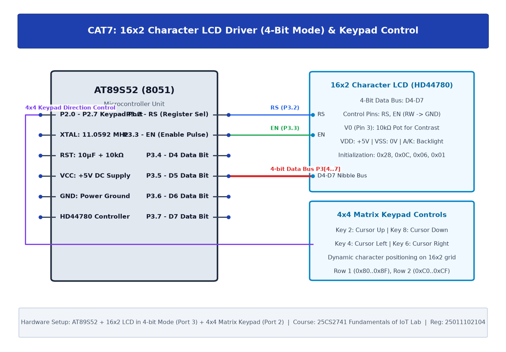

# TASK7A: 16x2 LCD Driver Development and Dynamic Display Control

## Experiment Metadata

| Field | Description |
|---|---|
| **EXP** | CAT7 |
| **DATE** | 24/08/2026 |
| **NAME OF EXP** | 16x2 LCD Driver Development and Dynamic Display Control |
| **HARDWARE SETUP / PLATFORM** | AT89S52 MCU, HD44780 16x2 LCD in 4-Bit Mode, RS (P2.0), EN (P2.1), Data Lines D4-D7 (P2.4-P2.7) |
| **TASK NO** | TASK7A |

---

## Circuit Diagram



### Pin Connections & Hardware Interface

| 8051 Pin | LCD Pin | Function |
|---|---|---|
| P2.0 | Pin 4 (RS) | Register Select (0=Command, 1=Data) |
| GND | Pin 5 (RW) | Read/Write tied to GND (Write Mode) |
| P2.1 | Pin 6 (EN) | Enable Clock Strobe Pulse (High-to-Low) |
| P2.4-P2.7 | Pin 11-14 (D4-D7) | 4-Bit Bidirectional Data Bus |
| +5V, GND | Pin 1, 2, 15, 16 | VDD, VSS, Backlight Anode, Cathode |

---

## Core Logic & Pseudocode

```text
1. Define 4-bit nibble transmission function:
   Send high nibble -> toggle Enable -> send low nibble -> toggle Enable.
2. Initialization sequence:
   Wait 20ms -> Command 0x28 (4-bit mode, 2 lines, 5x8 font) ->
   Command 0x0C (Display ON, cursor OFF) ->
   Command 0x06 (Entry mode auto-increment) ->
   Command 0x01 (Clear screen).
3. Transmit ASCII string 'FIoT LAB - 8051' to Row 1.
```

---

## Source Code Implementation

```c
#include <reg51.h>

sbit RS = P2^0;
sbit EN = P2^1;

void delay_ms(unsigned int ms) {
    unsigned int i, j;
    for(i=0; i<ms; i++) for(j=0; j<120; j++);
}

void lcd_send_nibble(unsigned char val, bit is_data) {
    P2 = (P2 & 0x0F) | (val & 0xF0);
    RS = is_data;
    EN = 1; delay_ms(1); EN = 0;
}

void lcd_cmd(unsigned char cmd) {
    lcd_send_nibble(cmd, 0);
    lcd_send_nibble(cmd << 4, 0);
    delay_ms(2);
}

void lcd_data(unsigned char dat) {
    lcd_send_nibble(dat, 1);
    lcd_send_nibble(dat << 4, 1);
    delay_ms(1);
}

void lcd_string(char *s) {
    while(*s) lcd_data(*s++);
}

void lcd_init() {
    delay_ms(50);
    lcd_cmd(0x28); // 4-bit mode, 2-line, 5x8 font
    lcd_cmd(0x0C); // Display ON, Cursor OFF
    lcd_cmd(0x06); // Auto-increment
    lcd_cmd(0x01); // Clear display
    delay_ms(5);
}

void main() {
    lcd_init();
    lcd_cmd(0x80); // Row 1
    lcd_string("FIoT LAB - 8051");
    lcd_cmd(0xC0); // Row 2
    lcd_string("TASK 7A PASSED");
    while(1);
}
```

---

## Inference & Technical Analysis

Using 4-bit mode halved the required GPIO pin count from 8 to 4 for data lines plus 2 control lines (RS, EN), reserving remaining microcontroller pins for sensors and actuators while retaining full display fidelity.
