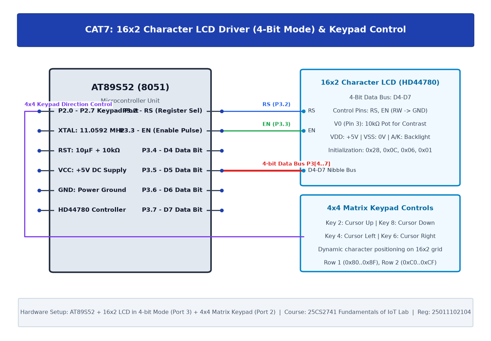

# TASK7B: 16x2 LCD Driver Development and Dynamic Display Control

## Experiment Metadata

| Field | Description |
|---|---|
| **EXP** | CAT7 |
| **DATE** | 24/08/2026 |
| **NAME OF EXP** | 16x2 LCD Driver Development and Dynamic Display Control |
| **HARDWARE SETUP / PLATFORM** | AT89S52 MCU, HD44780 16x2 LCD (4-bit mode), Keil C51 |
| **TASK NO** | TASK7B |

---

## Circuit Diagram



### Pin Connections & Hardware Interface

| 8051 Pin | LCD Pin | Function |
|---|---|---|
| P2.0, P2.1 | RS, EN | Command/Data & Strobe |
| P2.4-P2.7 | D4-D7 | 4-bit Data Nibbles |

---

## Core Logic & Pseudocode

```text
1. Initialize LCD in 4-bit mode.
2. Display string 'SHAM NITHISH - 25011102104' on display DDRAM.
3. In main loop:
   a. Send Command 0x18 (Shift entire display left).
   b. Delay 300 ms.
   c. Repeat to create marquee dynamic scrolling banner.
```

---

## Source Code Implementation

```c
#include <reg51.h>

sbit RS = P2^0;
sbit EN = P2^1;

void delay_ms(unsigned int ms) {
    unsigned int i, j;
    for(i=0; i<ms; i++) for(j=0; j<120; j++);
}

void lcd_cmd(unsigned char cmd) {
    P2 = (P2 & 0x0F) | (cmd & 0xF0); RS = 0; EN = 1; delay_ms(1); EN = 0;
    P2 = (P2 & 0x0F) | ((cmd << 4) & 0xF0); RS = 0; EN = 1; delay_ms(1); EN = 0;
    delay_ms(2);
}

void lcd_data(unsigned char dat) {
    P2 = (P2 & 0x0F) | (dat & 0xF0); RS = 1; EN = 1; delay_ms(1); EN = 0;
    P2 = (P2 & 0x0F) | ((dat << 4) & 0xF0); RS = 1; EN = 1; delay_ms(1); EN = 0;
    delay_ms(1);
}

void lcd_string(char *s) { while(*s) lcd_data(*s++); }

void main() {
    unsigned char i;
    delay_ms(50);
    lcd_cmd(0x28); lcd_cmd(0x0C); lcd_cmd(0x06); lcd_cmd(0x01); delay_ms(5);
    lcd_cmd(0x80);
    lcd_string("SHAM NITHISH - IoT");
    while(1) {
        for(i=0; i<16; i++) {
            lcd_cmd(0x18); // Shift display left
            delay_ms(350);
        }
    }
}
```

---

## Inference & Technical Analysis

HD44780 has 80 bytes of internal DDRAM (40 per line) but displays only 16 characters at once. Command 0x18 increments the display window start address without rewriting the DDRAM, enabling seamless hardware scrolling.
