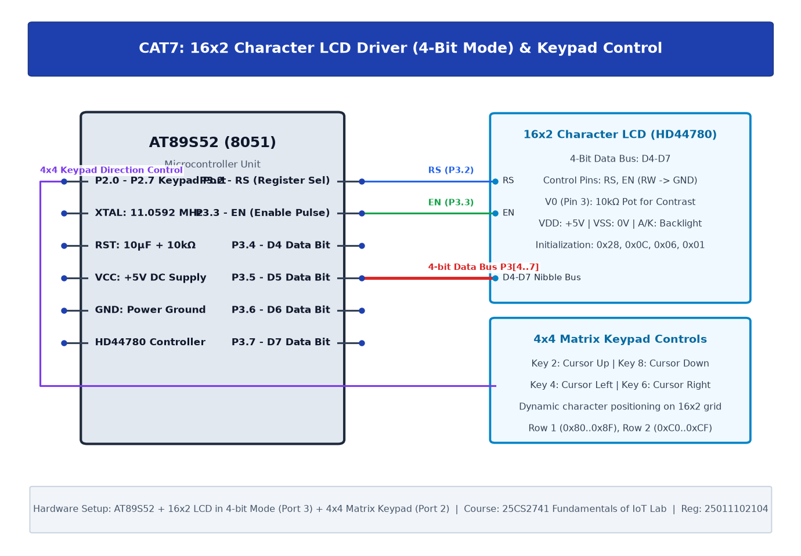

# TASK7C: 16x2 LCD Driver Development and Dynamic Display Control

## Experiment Metadata

| Field | Description |
|---|---|
| **EXP** | CAT7 |
| **DATE** | 24/08/2026 |
| **NAME OF EXP** | 16x2 LCD Driver Development and Dynamic Display Control |
| **HARDWARE SETUP / PLATFORM** | AT89S52 MCU, 4x4 Matrix Keypad (Port 0 with 10kΩ pull-up pack), 16x2 HD44780 LCD (Port 2) |
| **TASK NO** | TASK7C |

---

## Circuit Diagram



### Pin Connections & Hardware Interface

| 8051 Port | Hardware Connection | Function |
|---|---|---|
| P0.0-P0.3 | Keypad Rows R1-R4 | Row Drive (Active-Low) |
| P0.4-P0.7 | Keypad Columns C1-C4 | Column Sense Inputs |
| P2.0, P2.1 | LCD RS, EN | LCD Control Signals |
| P2.4-P2.7 | LCD D4-D7 | LCD 4-Bit Data Bus |

---

## Core Logic & Pseudocode

```text
1. Initialize LCD in 4-bit mode with cursor visible (0x0E).
2. Print prompt 'Enter Key: ' on Row 1.
3. In main loop:
   a. Scan 4x4 keypad on Port 0.
   b. When button press detected, translate to ASCII ('0'-'9', 'A'-'D', '*', '#').
   c. Write character to LCD at current cursor position.
   d. Wait for key release debounce.
```

---

## Source Code Implementation

```c
#include <reg51.h>

sbit RS = P2^0;
sbit EN = P2^1;

unsigned char code keymap[4][4] = {
    {'1', '2', '3', 'A'},
    {'4', '5', '6', 'B'},
    {'7', '8', '9', 'C'},
    {'*', '0', '#', 'D'}
};

void delay_ms(unsigned int ms) {
    unsigned int i, j;
    for(i=0; i<ms; i++) for(j=0; j<120; j++);
}

void lcd_cmd(unsigned char cmd) {
    P2 = (P2 & 0x0F) | (cmd & 0xF0); RS = 0; EN = 1; delay_ms(1); EN = 0;
    P2 = (P2 & 0x0F) | ((cmd << 4) & 0xF0); RS = 0; EN = 1; delay_ms(1); EN = 0;
    delay_ms(2);
}

void lcd_data(unsigned char dat) {
    P2 = (P2 & 0x0F) | (dat & 0xF0); RS = 1; EN = 1; delay_ms(1); EN = 0;
    P2 = (P2 & 0x0F) | ((dat << 4) & 0xF0); RS = 1; EN = 1; delay_ms(1); EN = 0;
    delay_ms(1);
}

void lcd_string(char *s) { while(*s) lcd_data(*s++); }

char read_keypad() {
    unsigned char r, c;
    for(r=0; r<4; r++) {
        P0 = ~(1 << r);
        for(c=0; c<4; c++) {
            if(!(P0 & (0x10 << c))) {
                delay_ms(20);
                if(!(P0 & (0x10 << c))) {
                    while(!(P0 & (0x10 << c)));
                    return keymap[r][c];
                }
            }
        }
    }
    return 0;
}

void main() {
    char key;
    delay_ms(50);
    lcd_cmd(0x28); lcd_cmd(0x0E); lcd_cmd(0x06); lcd_cmd(0x01); delay_ms(5);
    lcd_cmd(0x80); lcd_string("Key: ");
    while(1) {
        key = read_keypad();
        if(key) {
            lcd_data(key);
        }
    }
}
```

---

## Inference & Technical Analysis

Integrating matrix input with alphanumeric display completes the core Human-Machine Interface (HMI) embedded subsystem, allowing interactive telemetry verification and field parameter adjustment.
