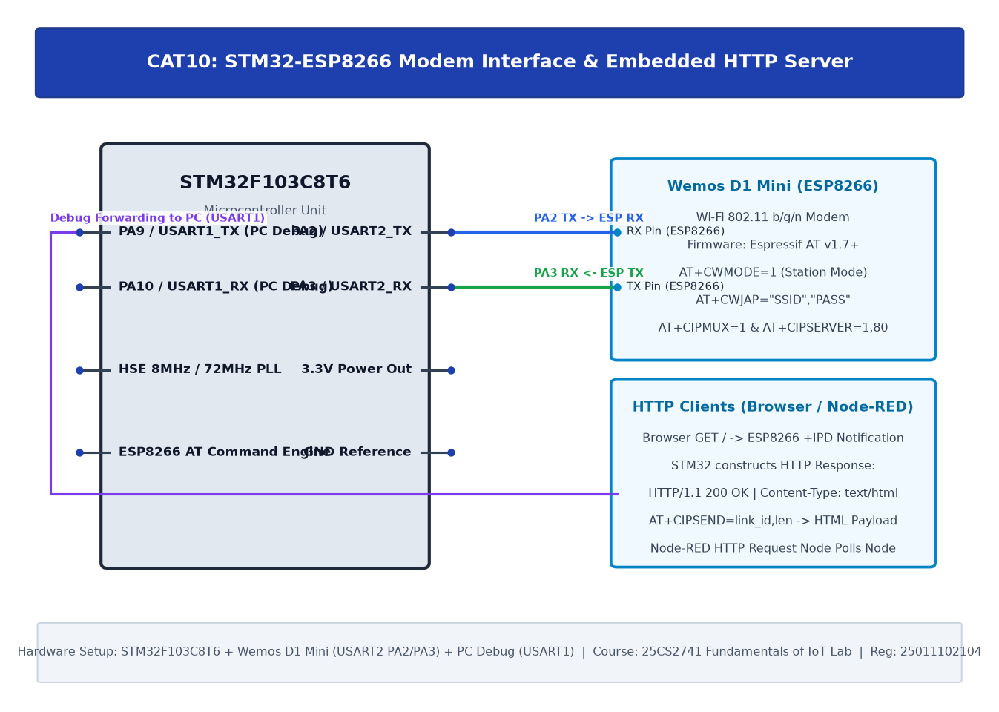

# TASK10C: STM32–Wemos Wi-Fi Modem Interface Using AT Commands & Embedded HTTP Server

## Experiment Metadata

| Field | Description |
|---|---|
| **EXP** | CAT10 |
| **DATE** | 12/10/2026 |
| **NAME OF EXP** | STM32–Wemos Wi-Fi Modem Interface Using AT Commands & Embedded HTTP Server |
| **HARDWARE SETUP / PLATFORM** | STM32F103C8T6, Wemos D1 Mini (ESP8266), Local Wi-Fi Network, PC Web Browser, Node-RED |
| **TASK NO** | TASK10C |

---

## Circuit Diagram



### Pin Connections & Hardware Interface

| STM32 Pin | Peripheral Connection | Function |
|---|---|---|
| PA2, PA3 | ESP8266 RX/TX | Modem Communication |
| Wi-Fi LAN | PC Browser & Node-RED | HTTP Client Endpoints |

---

## Core Logic & Pseudocode

```text
1. Maintain TCP server listening on Port 80.
2. In main loop:
   a. Listen on USART2 for incoming client frame: '+IPD,<link_id>,<len>:GET / ...'.
   b. Extract link_id.
   c. Prepare HTTP HTML response body: '<html><body><h1>STM32 IoT Node</h1></body></html>'.
   d. Send command: 'AT+CIPSEND=<link_id>,<len>\r\n'.
   e. Wait for prompt '> '.
   f. Send HTTP payload: 'HTTP/1.1 200 OK\r\nContent-Type: text/html\r\n...'.
   g. Close connection: 'AT+CIPCLOSE=<link_id>\r\n'.
3. Observe HTTP Request triggered from Node-RED HTTP node.
```

---

## Source Code Implementation

```c
#include "main.h"
#include <stdio.h>
#include <string.h>

UART_HandleTypeDef huart1;
UART_HandleTypeDef huart2;

void handle_http_request(int link_id) {
    char body[] = "<html><body><h1>STM32 IoT Node</h1><p>Status: Online</p></body></html>";
    char resp[256];
    char cmd[32];
    int body_len = strlen(body);
    int total_len;

    sprintf(resp, "HTTP/1.1 200 OK\r\nContent-Type: text/html\r\nContent-Length: %d\r\n\r\n%s", body_len, body);
    total_len = strlen(resp);

    sprintf(cmd, "AT+CIPSEND=%d,%d\r\n", link_id, total_len);
    HAL_UART_Transmit(&huart2, (uint8_t*)cmd, strlen(cmd), 500);
    HAL_Delay(100);
    HAL_UART_Transmit(&huart2, (uint8_t*)resp, total_len, 1000);
    HAL_Delay(100);

    sprintf(cmd, "AT+CIPCLOSE=%d\r\n", link_id);
    HAL_UART_Transmit(&huart2, (uint8_t*)cmd, strlen(cmd), 500);
}

int main(void) {
    char buf[512];
    HAL_Init();
    SystemClock_Config();
    MX_GPIO_Init();
    MX_USART1_UART_Init();
    MX_USART2_UART_Init();

    while (1) {
        if (HAL_UART_Receive(&huart2, (uint8_t*)buf, sizeof(buf)-1, 200) == HAL_OK) {
            char *ipd = strstr(buf, "+IPD,");
            if (ipd) {
                int link_id = ipd[5] - '0';
                handle_http_request(link_id);
            }
        }
    }
}
```

---

## Inference & Technical Analysis

Splitting CIPSEND into command and payload phases ensures packet pacing without buffer overflow. Node-RED successfully retrieved the HTTP status payload, establishing an edge-to-dashboard pipeline.
