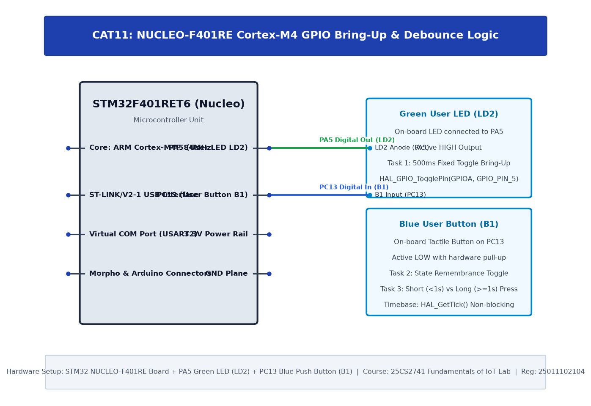

# TASK11A: STM32F401RE Cortex-M4: GPIO and User Input Programming

## Experiment Metadata

| Field | Description |
|---|---|
| **EXP** | CAT11 |
| **DATE** | 14/10/2026 |
| **NAME OF EXP** | STM32F401RE Cortex-M4: GPIO and User Input Programming |
| **HARDWARE SETUP / PLATFORM** | STM32 NUCLEO-F401RE Board (ARM Cortex-M4 @ 84 MHz with FPU), User Button B1 (PC13, active-low), User Green LED LD2 (PA5) |
| **TASK NO** | TASK11A |

---

## Circuit Diagram



### Pin Connections & Hardware Interface

| Nucleo Pin | Target Component | Function |
|---|---|---|
| PC13 | Blue User Button B1 (Active-Low) | GPIO Input with Pull-Up |
| PA5 | Green User LED LD2 | GPIO Output Push-Pull |
| CN1 (USB) | On-board ST-LINK V2-1 | SWD Debugging & Virtual COM Port |

---

## Core Logic & Pseudocode

```text
1. Initialize HAL and configure System Clock to 84 MHz.
2. Enable GPIOA and GPIOC clocks.
3. Configure PA5 as GPIO_MODE_OUTPUT_PP (LD2).
4. Configure PC13 as GPIO_MODE_INPUT with GPIO_PULLUP (B1).
5. In superloop:
   a. If HAL_GPIO_ReadPin(GPIOC, GPIO_PIN_13) == GPIO_PIN_RESET (pressed):
      i. Debounce 20ms.
      ii. If still pressed, toggle PA5 (LD2).
      iii. Wait for release.
```

---

## Source Code Implementation

```c
#include "main.h"

void SystemClock_Config(void);
static void MX_GPIO_Init(void);

int main(void) {
    HAL_Init();
    SystemClock_Config();
    MX_GPIO_Init();

    while (1) {
        if (HAL_GPIO_ReadPin(GPIOC, GPIO_PIN_13) == GPIO_PIN_RESET) {
            HAL_Delay(25); // Debounce
            if (HAL_GPIO_ReadPin(GPIOC, GPIO_PIN_13) == GPIO_PIN_RESET) {
                HAL_GPIO_TogglePin(GPIOA, GPIO_PIN_5);
                while (HAL_GPIO_ReadPin(GPIOC, GPIO_PIN_13) == GPIO_PIN_RESET);
                HAL_Delay(25);
            }
        }
    }
}
```

---

## Inference & Technical Analysis

The STM32F401RE Cortex-M4 architecture delivers high execution throughput at 84 MHz with single-cycle I/O port manipulation via AHB1 bus. Hardware debounce circuit on Nucleo-F401RE complemented by software filtering produces reliable state capture.
