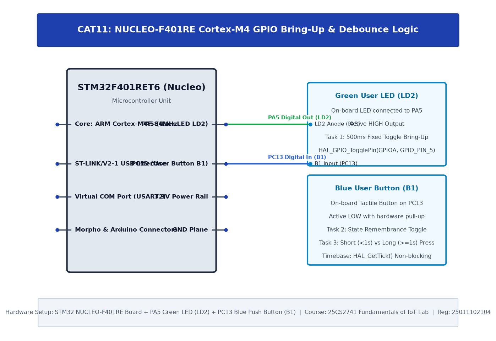

# TASK11B: STM32F401RE Cortex-M4: GPIO and User Input Programming

## Experiment Metadata

| Field | Description |
|---|---|
| **EXP** | CAT11 |
| **DATE** | 14/10/2026 |
| **NAME OF EXP** | STM32F401RE Cortex-M4: GPIO and User Input Programming |
| **HARDWARE SETUP / PLATFORM** | STM32 NUCLEO-F401RE Board, User Button B1 (PC13), User LED LD2 (PA5), SysTick Timer |
| **TASK NO** | TASK11B |

---

## Circuit Diagram



### Pin Connections & Hardware Interface

| Nucleo Pin | Target Component | Function |
|---|---|---|
| PC13 | Blue User Button B1 | Multi-State Input |
| PA5 | Green User LED LD2 | Pulse / Blink Output |

---

## Core Logic & Pseudocode

```text
1. Initialize HAL and System Clock.
2. In superloop:
   a. Detect button press: start_time = HAL_GetTick().
   b. Wait until button released.
   c. press_duration = HAL_GetTick() - start_time.
   d. If press_duration < 1000 ms (Short Press):
      Toggle LED once.
   e. If press_duration >= 1000 ms (Long Press):
      Blink LED rapidly 5 times to indicate mode change.
```

---

## Source Code Implementation

```c
#include "main.h"

int main(void) {
    HAL_Init();
    SystemClock_Config();
    MX_GPIO_Init();

    while (1) {
        if (HAL_GPIO_ReadPin(GPIOC, GPIO_PIN_13) == GPIO_PIN_RESET) {
            uint32_t press_start = HAL_GetTick();
            HAL_Delay(20);
            while (HAL_GPIO_ReadPin(GPIOC, GPIO_PIN_13) == GPIO_PIN_RESET);
            uint32_t duration = HAL_GetTick() - press_start;

            if (duration < 1000) {
                // Short Press: Toggle LED
                HAL_GPIO_TogglePin(GPIOA, GPIO_PIN_5);
            } else {
                // Long Press: 5 rapid flashes
                for (int i = 0; i < 5; i++) {
                    HAL_GPIO_WritePin(GPIOA, GPIO_PIN_5, GPIO_PIN_SET);
                    HAL_Delay(100);
                    HAL_GPIO_WritePin(GPIOA, GPIO_PIN_5, GPIO_PIN_RESET);
                    HAL_Delay(100);
                }
            }
        }
    }
}
```

---

## Inference & Technical Analysis

Using HAL_GetTick() provides non-blocking elapsed time computation with millisecond accuracy, enabling multi-gesture user interfaces on a single physical tactile button.
