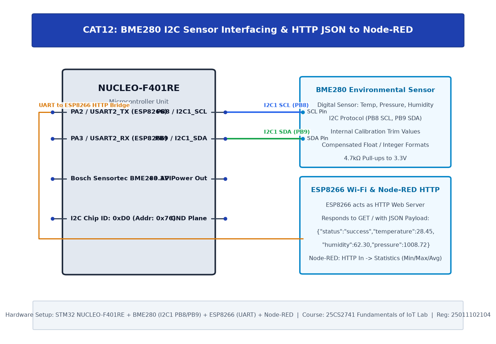

# TASK12C: BME280 Sensor Interfacing Using I2C and Bosch Sensor API + HTTP Node Analytics

## Experiment Metadata

| Field | Description |
|---|---|
| **EXP** | CAT12 |
| **DATE** | 23/10/2026 |
| **NAME OF EXP** | BME280 Sensor Interfacing Using I2C and Bosch Sensor API + HTTP Node Analytics |
| **HARDWARE SETUP / PLATFORM** | STM32 NUCLEO-F401RE, BME280 Sensor (I2C1), ESP8266 Wi-Fi Modem (USART2), Node-RED Dashboard |
| **TASK NO** | TASK12C |

---

## Circuit Diagram



### Pin Connections & Hardware Interface

| STM32 Pin | Peripheral Connection | Function |
|---|---|---|
| PB8, PB9 | BME280 SCL, SDA | Environmental Sensor Bus |
| PA2, PA3 | ESP8266 RX/TX | Wi-Fi Telemetry Transmitter |

---

## Core Logic & Pseudocode

```text
1. Read compensated sensor values from BME280.
2. Listen for HTTP GET requests from Node-RED over ESP8266 TCP server.
3. Formulate JSON response payload:
   '{"temperature": 25.4, "pressure": 1013.2, "humidity": 55.8}'.
4. Transmit HTTP 200 OK header with Content-Type: application/json.
5. Close TCP client connection.
```

---

## Source Code Implementation

```c
#include "main.h"
#include <stdio.h>
#include <string.h>

void send_json_telemetry(int link_id, float t, float p, float h) {
    char json[128];
    char resp[256];
    char cmd[32];
    sprintf(json, "{\"temperature\": %.2f, \"pressure\": %.2f, \"humidity\": %.2f}", t, p, h);
    sprintf(resp, "HTTP/1.1 200 OK\r\nContent-Type: application/json\r\nContent-Length: %d\r\n\r\n%s", (int)strlen(json), json);

    sprintf(cmd, "AT+CIPSEND=%d,%d\r\n", link_id, (int)strlen(resp));
    HAL_UART_Transmit(&huart2, (uint8_t*)cmd, strlen(cmd), 500);
    HAL_Delay(100);
    HAL_UART_Transmit(&huart2, (uint8_t*)resp, strlen(resp), 1000);
    HAL_Delay(100);

    sprintf(cmd, "AT+CIPCLOSE=%d\r\n", link_id);
    HAL_UART_Transmit(&huart2, (uint8_t*)cmd, strlen(cmd), 500);
}
```

---

## Inference & Technical Analysis

Encoding telemetry in lightweight JSON format enables native interoperability with cloud platforms, REST clients, and Node-RED analytics pipelines.
