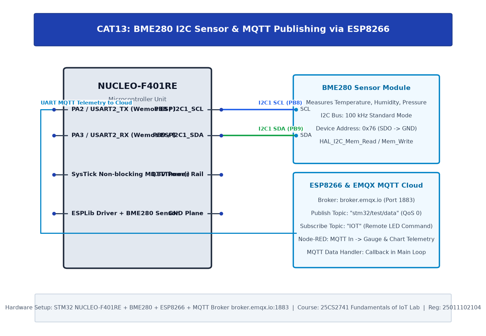

# TASK13: BME280 Sensor Interfacing Using Custom Built ESP8266 API

## Experiment Metadata

| Field | Description |
|---|---|
| **EXP** | CAT13 |
| **DATE** | 27/10/2026 |
| **NAME OF EXP** | BME280 Sensor Interfacing Using Custom Built ESP8266 API |
| **HARDWARE SETUP / PLATFORM** | STM32 NUCLEO-F401RE, BME280 Sensor (I2C1), ESP8266 Wi-Fi Modem (USART2), Custom ESPLib Driver |
| **TASK NO** | TASK13 |

---

## Circuit Diagram



### Pin Connections & Hardware Interface

| Nucleo Pin | External Module | Function |
|---|---|---|
| PB8, PB9 | BME280 SCL, SDA | Sensor Bus |
| PA2, PA3 | ESP8266 RX, TX | High-Speed Modem Interface |

---

## Core Logic & Pseudocode

```text
1. Modularize AT command handling into ESPLib driver layer (ESPLib.h, ESPLib.c).
2. Initialize driver: ESP8266_Init(StationMode, huart2).
3. Connect to Wi-Fi: ESP8266_wifiConnect("SSID", "PASSWORD").
4. Query and print assigned IP address.
5. In superloop: read BME280 and maintain network connection state.
```

---

## Source Code Implementation

```c
#include "main.h"
#include "ESPLib.h"
#include "bme280.h"

int main(void) {
    HAL_Init();
    SystemClock_Config();
    MX_GPIO_Init();
    MX_I2C1_Init();
    MX_USART2_UART_Init();

    // Initialize custom Wi-Fi Modem API
    ESP8266_Init(StationMode, huart2);
    ESP8266_wifiConnect("Campus_WiFi", "SecurePassword");

    while (1) {
        HAL_Delay(2000);
    }
}
```

---

## Inference & Technical Analysis

Encapsulating raw AT command strings into a modular C library (ESPLib) abstracts transport-layer complexities, enhances codebase maintainability, and provides reusability across diverse embedded projects.
