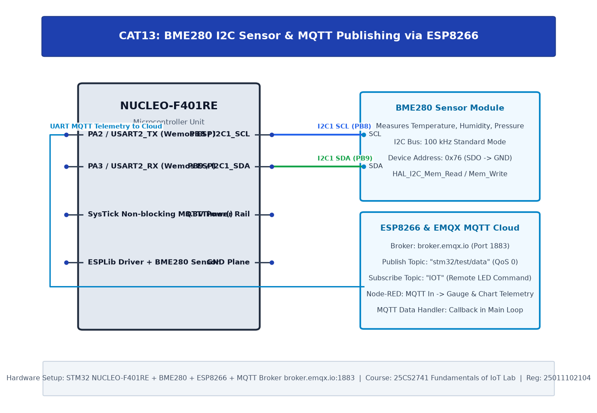

# CAT14: BME280 Sensor Interfacing Using MQTT Cloud Publishing & Node-RED Analytics

## 1. Experiment Overview

| Field | Details |
|---|---|
| **Experiment Identifier** | CAT14 |
| **Date of Execution** | 04/11/2026 |
| **Hardware Platform** | STM32 + BME280 + ESP8266 + MQTT |
| **Curriculum Scope** | Full-stack IoT edge telemetry node publishing real-time environmental data over MQTT to EMQX and Node-RED. |

---

## 2. Hardware Circuit Diagram

---

## 3. Subtask Directory Index

| Task ID | Folder Link | Description & Objective |
|---|---|---|
| **TASK14** | [TASK14](TASK14/) | Full-Stack IoT Telemetry Node Publishing Sensor Telemetry over MQTT to EMQX & Node-RED |

---

## 4. Platform Specifications & Architecture

- **Microcontroller**: STM32 + BME280 + ESP8266 + MQTT
- **Development Toolchain**: Keil C51 / Keil MDK-ARM with STM32CubeMX HAL Driver Layer.
- **Verification**: Complete source code, Keil project configurations, compiled `.hex` binaries, and circuit schematics are organized within each subtask directory.
