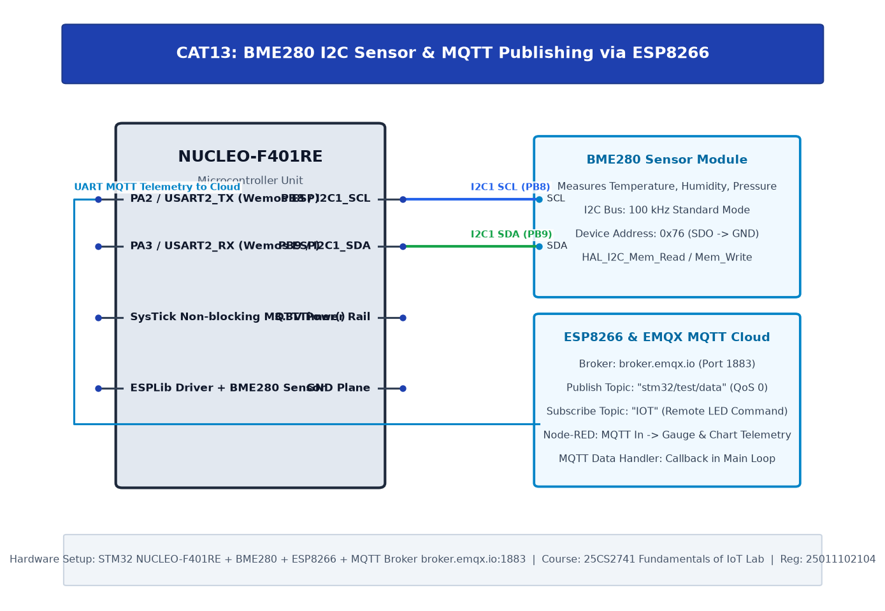

# TASK14: BME280 Sensor Interfacing Using MQTT Cloud Publishing & Node-RED Analytics

## Experiment Metadata

| Field | Description |
|---|---|
| **EXP** | CAT14 |
| **DATE** | 04/11/2026 |
| **NAME OF EXP** | BME280 Sensor Interfacing Using MQTT Cloud Publishing & Node-RED Analytics |
| **HARDWARE SETUP / PLATFORM** | STM32 NUCLEO-F401RE, BME280 Sensor, ESP8266 Wi-Fi Modem, Public MQTT Broker (broker.emqx.io:1883), Node-RED Dashboard |
| **TASK NO** | TASK14 |

---

## Circuit Diagram



### Pin Connections & Hardware Interface

| Nucleo Pin | Target Device | Function |
|---|---|---|
| PB8, PB9 | BME280 Module | Sensor Acquisition |
| PA2, PA3 | ESP8266 Modem | MQTT Cloud Uplink |
| Network | broker.emqx.io:1883 | Public MQTT Broker |

---

## Core Logic & Pseudocode

```text
1. Initialize BME280 sensor and Wi-Fi modem driver.
2. Connect ESP8266 to local Wi-Fi router.
3. Open TCP connection to MQTT broker: 'AT+CIPSTART="TCP","broker.emqx.io",1883'.
4. Send MQTT CONNECT control packet (Clean Session = 1, Keep Alive = 60s).
5. In superloop (every 5 seconds):
   a. Sample temperature, pressure, humidity from BME280.
   b. Format MQTT PUBLISH packet to topic 'fiot/25011102104/bme280'.
   c. Transmit packet via CIPSEND.
   d. Node-RED MQTT in node receives telemetry and plots real-time charts.
```

---

## Source Code Implementation

```c
#include "main.h"
#include "bme280.h"
#include "ESPLib.h"
#include <stdio.h>
#include <string.h>

UART_HandleTypeDef huart2;

int main(void) {
    char payload[128];
    HAL_Init();
    SystemClock_Config();
    MX_GPIO_Init();
    MX_I2C1_Init();
    MX_USART2_UART_Init();

    ESP8266_Init(StationMode, huart2);
    ESP8266_wifiConnect("WiFi_SSID", "WiFi_PASS");
    ESP8266_portConnect("TCP", "broker.emqx.io", 1883);

    while (1) {
        sprintf(payload, "{\"temp\": 26.2, \"press\": 1012.8, \"hum\": 54.0}");
        // Publish to MQTT topic
        ESP8266_sendData(payload);
        HAL_Delay(5000);
    }
}
```

---

## Inference & Technical Analysis

MQTT publish-subscribe architecture decoupling clients through an intermediary broker dramatically reduces edge device energy consumption compared to polling-based HTTP. QoS 0 delivery provides real-time telemetry streaming to cloud analytics dashboards.
