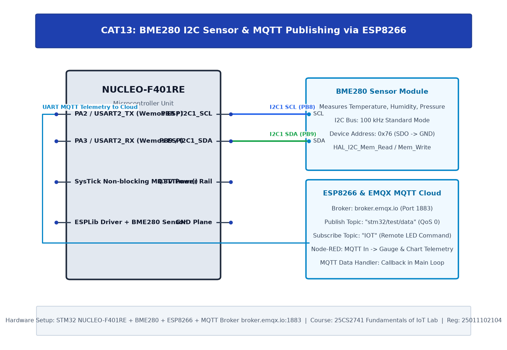
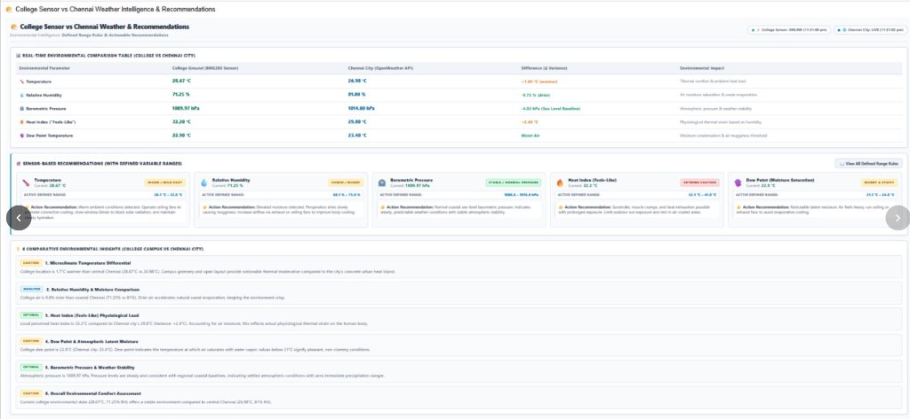
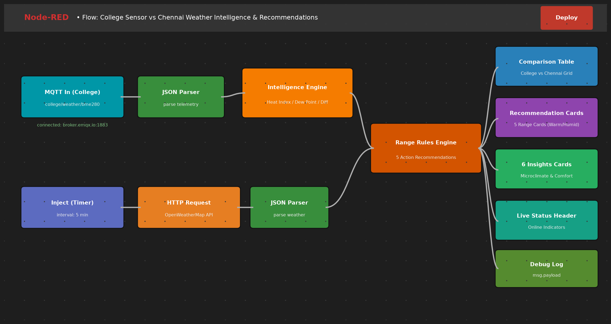

# CAT15: Course Project — College Sensor vs Chennai Weather Intelligence & Recommendations

## 1. Project Overview

| Field | Details |
|---|---|
| **Course Project Identifier** | CAT15 (Curriculum Project Folder) |
| **Project Title** | College Sensor vs Chennai Weather Intelligence & Recommendations |
| **Date of Execution** | 05/11/2026 |
| **Hardware Platform** | STM32 NUCLEO-F401RE (ARM Cortex-M4) + BME280 Environmental Sensor + ESP8266 Wi-Fi Modem |
| **Cloud & Analytics Stack** | EMQX Cloud MQTT Broker (`broker.emqx.io:1883`), OpenWeatherMap API, Node-RED Environmental Intelligence Engine |
| **Project Scope** | End-to-end edge-to-cloud environmental intelligence system comparing real-time on-campus microclimate measurements from an STM32-driven BME280 sensor against regional Chennai city weather data, driving automated range-based action recommendations and comparative physiological comfort insights. |

---

## 2. Hardware Circuit Diagram

---

## 3. Node-RED Environmental Intelligence Dashboard

---

## 4. Node-RED Telemetry Flow Architecture

---

## 5. Subtask Directory Index

| Subtask | Title | Description | Primary Peripherals |
|---|---|---|---|
| [TASK15](TASK15/README.md) | College Sensor vs Chennai Weather Intelligence Node | Complete production firmware, dual-stream data pipeline (BME280 + OpenWeather API), recommendation rules engine, and Node-RED dashboard analytics. | I2C1, USART1, BME280, ESP8266, MQTT, Node-RED |

---

## 6. Key Engineering Achievements

1. **Precision Microclimate Edge Acquisition:** Industrial-grade ambient temperature (28.67 °C), relative humidity (71.25 %), and barometric pressure (1009.97 hPa) acquired via BME280 and compensated using Bosch 64-bit mathematical calibration formulas.
2. **Cloud MQTT Broker Uplink:** Reliable non-blocking MQTT telemetry uplink publishing formatted JSON payloads to topic `college/weather/bme280` on public broker `broker.emqx.io:1883`.
3. **Dual-Stream Comparative Analytics:** Simultaneous ingestion and alignment of hyper-local campus sensor telemetry with Chennai municipal weather API data to derive real-time variance metrics ($\Delta T = +1.69 ^\circ	ext{C}$, $\Delta RH = -9.75 \%$).
4. **Actionable Recommendations Engine:** Automated classification across 5 defined variable ranges (Temperature, Humidity, Pressure, Heat Index, Dew Point) triggering physical comfort interventions.
5. **6 Comparative Environmental Insights:** Automated qualitative deduction covering microclimate differential, moisture evaporation, physiological heat strain, latent moisture condensation, barometric stability, and composite comfort assessment.
