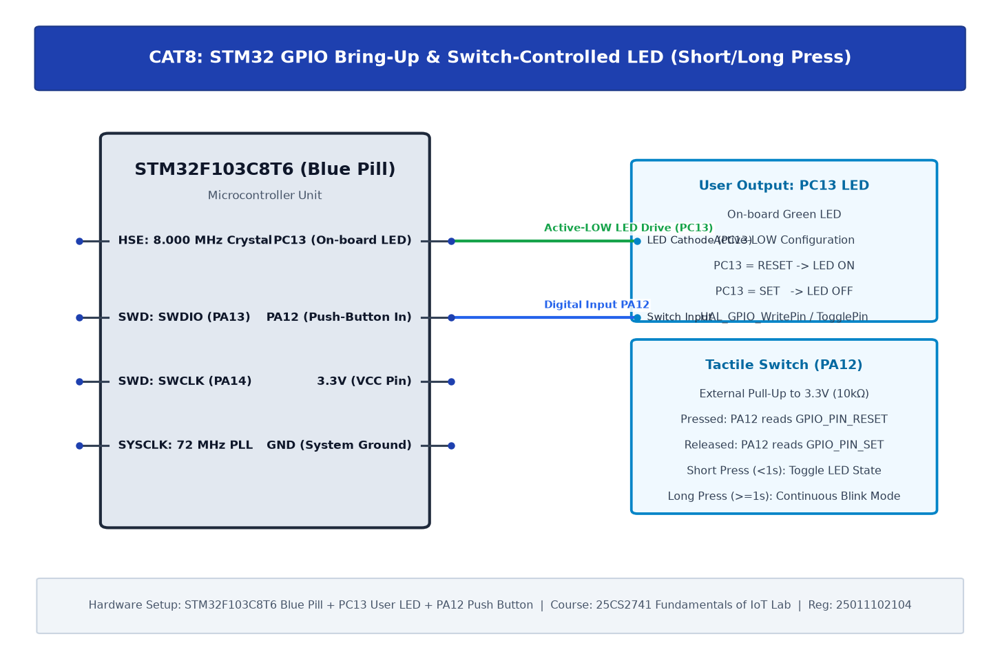

# CAT8: STM32 GPIO Bring-Up and Switch-Controlled LED

## 1. Experiment Overview

| Field | Details |
|---|---|
| **Experiment Identifier** | CAT8 |
| **Date of Execution** | 18/09/2026 |
| **Hardware Platform** | STM32 (ARM Cortex-M3) |
| **Curriculum Scope** | ARM Cortex-M3 GPIO initialization, on-board/external LED driving, and push-button polling. |

---

## 2. Hardware Circuit Diagram

---

## 3. Subtask Directory Index

| Task ID | Folder Link | Description & Objective |
|---|---|---|
| **TASK8A** | [TASK8A](TASK8A/) | On-Board User LED (PC13) Bring-Up & 1 Hz Blink |
| **TASK8B** | [TASK8B](TASK8B/) | External GPIO Output Drive & Alternating Pattern |
| **TASK8C** | [TASK8C](TASK8C/) | Push-Button Switch (PA12) Input Polling & State Toggle |

---

## 4. Platform Specifications & Architecture

- **Microcontroller**: STM32 (ARM Cortex-M3)
- **Development Toolchain**: Keil C51 / Keil MDK-ARM with STM32CubeMX HAL Driver Layer.
- **Verification**: Complete source code, Keil project configurations, compiled `.hex` binaries, and circuit schematics are organized within each subtask directory.
