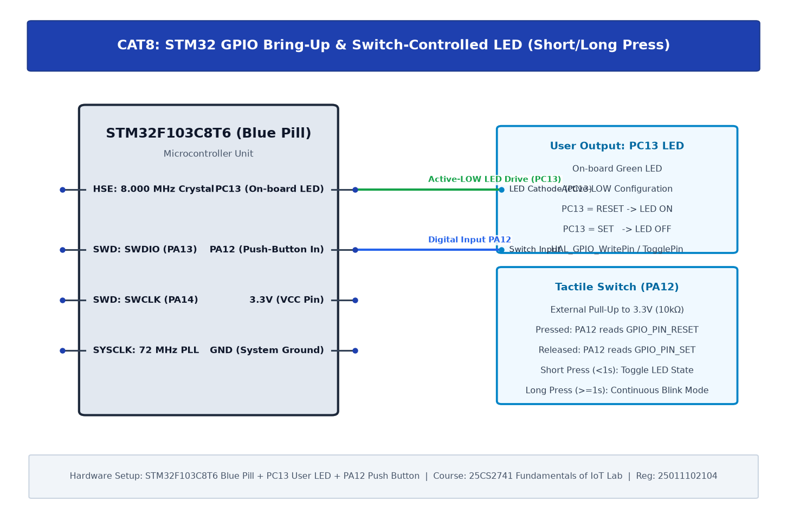

# TASK8A: STM32 GPIO Bring-Up and Switch-Controlled LED

## Experiment Metadata

| Field | Description |
|---|---|
| **EXP** | CAT8 |
| **DATE** | 18/09/2026 |
| **NAME OF EXP** | STM32 GPIO Bring-Up and Switch-Controlled LED |
| **HARDWARE SETUP / PLATFORM** | STM32F103C8T6 (Blue Pill), ARM Cortex-M3 (72 MHz), On-board User LED (PC13, active-low), ST-LINK V2 SWD |
| **TASK NO** | TASK8A |

---

## Circuit Diagram



### Pin Connections & Hardware Interface

| STM32 Pin | Peripheral / Connection | Function |
|---|---|---|
| PC13 | On-board Green LED (Active-Low) | GPIO Output Push-Pull |
| SWCLK (PA14), SWDIO (PA13) | ST-LINK V2 SWD Header | Serial Wire Debug & Flash Programming |
| 3.3V, GND | ST-LINK V2 Power Rail | Power Supply |

---

## Core Logic & Pseudocode

```text
1. Initialize HAL System Clock to 72 MHz using 8 MHz external crystal (HSE) and PLL.
2. Enable GPIOC clock: __HAL_RCC_GPIOC_CLK_ENABLE().
3. Configure PC13 as GPIO_MODE_OUTPUT_PP, GPIO_NOPULL, GPIO_SPEED_FREQ_LOW.
4. Set PC13 HIGH initially (LED OFF).
5. In superloop:
   a. HAL_GPIO_TogglePin(GPIOC, GPIO_PIN_13).
   b. HAL_Delay(1000).
```

---

## Source Code Implementation

```c
#include "main.h"

void SystemClock_Config(void);
static void MX_GPIO_Init(void);

int main(void) {
    HAL_Init();
    SystemClock_Config();
    MX_GPIO_Init();

    while (1) {
        HAL_GPIO_TogglePin(GPIOC, GPIO_PIN_13);
        HAL_Delay(1000); // 1 Hz toggle rate
    }
}

static void MX_GPIO_Init(void) {
    GPIO_InitTypeDef GPIO_InitStruct = {0};
    __HAL_RCC_GPIOC_CLK_ENABLE();
    HAL_GPIO_WritePin(GPIOC, GPIO_PIN_13, GPIO_PIN_SET);
    GPIO_InitStruct.Pin = GPIO_PIN_13;
    GPIO_InitStruct.Mode = GPIO_MODE_OUTPUT_PP;
    GPIO_InitStruct.Pull = GPIO_NOPULL;
    GPIO_InitStruct.Speed = GPIO_SPEED_FREQ_LOW;
    HAL_GPIO_Init(GPIOC, &GPIO_InitStruct);
}
```

---

## Inference & Technical Analysis

On-board LED on PC13 is connected in active-low sink configuration. Driving PC13 LOW completes the circuit to 3.3V, illuminating the LED. HAL_Delay utilizes the ARM Cortex-M SysTick interrupt configured for 1 ms timebase.
