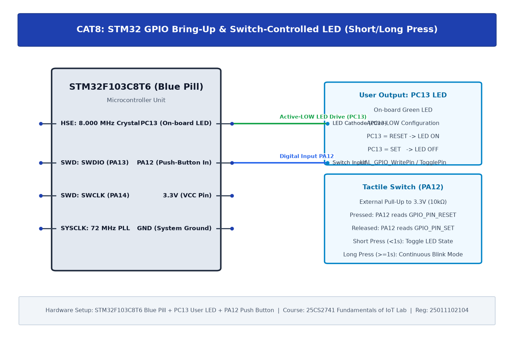

# TASK8B: STM32 GPIO Bring-Up and Switch-Controlled LED

## Experiment Metadata

| Field | Description |
|---|---|
| **EXP** | CAT8 |
| **DATE** | 18/09/2026 |
| **NAME OF EXP** | STM32 GPIO Bring-Up and Switch-Controlled LED |
| **HARDWARE SETUP / PLATFORM** | STM32F103C8T6 (Blue Pill), External LED with 330Ω Resistor on PB0, ST-LINK V2 |
| **TASK NO** | TASK8B |

---

## Circuit Diagram



### Pin Connections & Hardware Interface

| STM32 Pin | Peripheral Connection | Function |
|---|---|---|
| PB0 | External LED Anode (via 330Ω to GND) | Active-High Output Drive |
| PC13 | On-board LED | Status Output |
| 3.3V, GND | Breadboard Power Rail | 3.3V Regulated Rail |

---

## Core Logic & Pseudocode

```text
1. Initialize HAL Core and configure System Clock.
2. Enable GPIOB and GPIOC peripheral clocks.
3. Configure PB0 as GPIO_MODE_OUTPUT_PP, GPIO_NOPULL.
4. In superloop:
   a. HAL_GPIO_WritePin(GPIOB, GPIO_PIN_0, GPIO_PIN_SET);
   b. HAL_Delay(500);
   c. HAL_GPIO_WritePin(GPIOB, GPIO_PIN_0, GPIO_PIN_RESET);
   d. HAL_Delay(500);
```

---

## Source Code Implementation

```c
#include "main.h"

void SystemClock_Config(void);
static void MX_GPIO_Init(void);

int main(void) {
    HAL_Init();
    SystemClock_Config();
    MX_GPIO_Init();

    while (1) {
        HAL_GPIO_WritePin(GPIOB, GPIO_PIN_0, GPIO_PIN_SET);
        HAL_GPIO_WritePin(GPIOC, GPIO_PIN_13, GPIO_PIN_RESET);
        HAL_Delay(500);
        HAL_GPIO_WritePin(GPIOB, GPIO_PIN_0, GPIO_PIN_RESET);
        HAL_GPIO_WritePin(GPIOC, GPIO_PIN_13, GPIO_PIN_SET);
        HAL_Delay(500);
    }
}
```

---

## Inference & Technical Analysis

External LED driven in active-high configuration demonstrates source driving capability (up to 20mA per GPIO pin, subject to STM32 total package current limit of 150mA).
