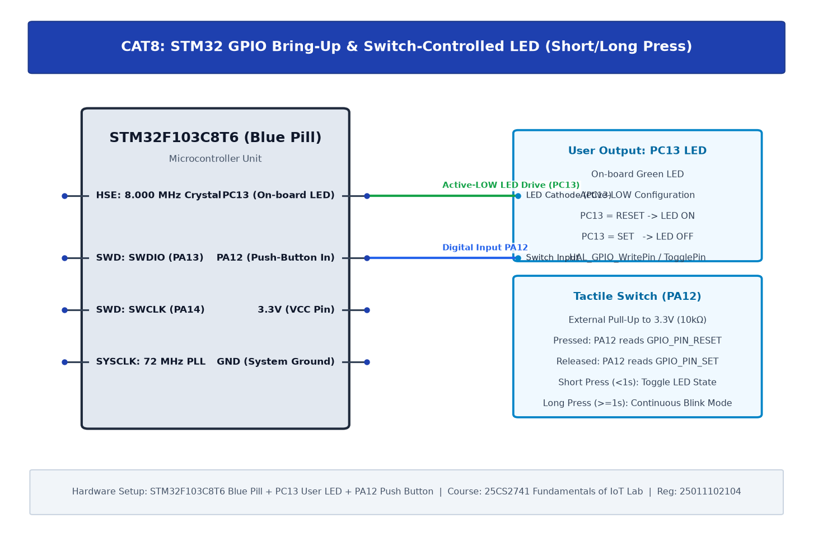

# TASK8C: STM32 GPIO Bring-Up and Switch-Controlled LED

## Experiment Metadata

| Field | Description |
|---|---|
| **EXP** | CAT8 |
| **DATE** | 18/09/2026 |
| **NAME OF EXP** | STM32 GPIO Bring-Up and Switch-Controlled LED |
| **HARDWARE SETUP / PLATFORM** | STM32F103C8T6, Push-Button Switch on PA12 (Input with internal Pull-Up), LED on PC13 |
| **TASK NO** | TASK8C |

---

## Circuit Diagram



### Pin Connections & Hardware Interface

| STM32 Pin | Peripheral Connection | Function |
|---|---|---|
| PA12 | Push Button Switch to GND | Active-Low Input (Internal Pull-Up) |
| PC13 | On-Board LED (Cathode) | Indicator Output |

---

## Core Logic & Pseudocode

```text
1. Initialize HAL Core and System Clock.
2. Configure PA12 as GPIO_MODE_INPUT with GPIO_PULLUP.
3. Configure PC13 as GPIO_MODE_OUTPUT_PP.
4. In superloop:
   a. Read button state: state = HAL_GPIO_ReadPin(GPIOA, GPIO_PIN_12).
   b. If state == GPIO_PIN_RESET (pressed):
      i. Debounce delay 20ms.
      ii. If still pressed, toggle PC13 LED.
      iii. Wait while button remains pressed (release debounce).
```

---

## Source Code Implementation

```c
#include "main.h"

void SystemClock_Config(void);
static void MX_GPIO_Init(void);

int main(void) {
    HAL_Init();
    SystemClock_Config();
    MX_GPIO_Init();

    while (1) {
        if (HAL_GPIO_ReadPin(GPIOA, GPIO_PIN_12) == GPIO_PIN_RESET) {
            HAL_Delay(20); // Debounce
            if (HAL_GPIO_ReadPin(GPIOA, GPIO_PIN_12) == GPIO_PIN_RESET) {
                HAL_GPIO_TogglePin(GPIOC, GPIO_PIN_13);
                while (HAL_GPIO_ReadPin(GPIOA, GPIO_PIN_12) == GPIO_PIN_RESET);
                HAL_Delay(20);
            }
        }
    }
}
```

---

## Inference & Technical Analysis

Internal 40kΩ pull-up resistor on PA12 establishes default 3.3V logic HIGH when switch is open. Pressing switch connects pin directly to GND. Software debounce state machine eliminates bounce chatter.
