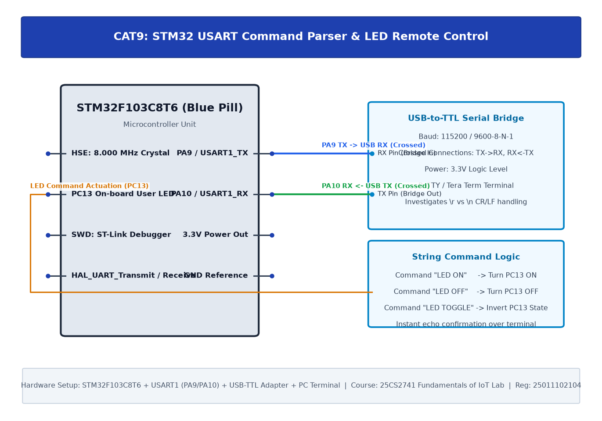

# EXPERIMENT DETAILS

| Field | Details |
|---|---|
| **EXP** | CONTINUOUS LAB EVALUATION-9 |
| **DATE** | 28/09/2026 (Week 9) |
| **NAME OF EXP** | STM32 UART Command Controlled LED |
| **HARDWARE SETUP / PLATFORM** | STM32F103C8T6 Blue Pill + USART1 + USB-to-TTL Serial Bridge + PuTTY Terminal |
| **TASK NO** | Task 9A: Basic UART Communication & Task 9B: String-Based Command Parser |

---

## 1. Problem Statement

Establish full-duplex asynchronous serial communication between the STM32F103C8T6 and a host computer using the STM32 HAL library:
1. **Task 9A — Basic UART Communication**:
   - Transmit a test string repeatedly to a PC terminal.
   - Receive incoming characters and echo them back immediately to verify transceiver timing.
2. **Task 9B — String-Based Command Logic**:
   - Implement a command parser that decodes ASCII string commands ending with `\r\n`:
     - `LED ON` $\rightarrow$ Turn on `PC13` LED, respond `LED turned ON\r\n`
     - `LED OFF` $\rightarrow$ Turn off `PC13` LED, respond `LED turned OFF\r\n`
     - `LED TOGGLE` $\rightarrow$ Invert `PC13` state, respond `LED toggled\r\n`

---

## 2. Circuit Diagram



### Hardware Connections
- **USART1 Pins**:
  - `PA9`: `USART1_TX` (Transmit) -> Connected to USB-to-TTL **RXD** pin.
  - `PA10`: `USART1_RX` (Receive) <- Connected to USB-to-TTL **TXD** pin.
  - `GND`: Common ground reference.
  - Logic Level: 3.3V CMOS.
- **Serial Configuration**:
  - Baud Rate: 9600 bps (or 115200 bps)
  - Word Length: 8 data bits
  - Parity: None
  - Stop Bits: 1
  - Flow Control: None

---

## 3. Core Logic & Source Code

### Core HAL APIs Used
```c
HAL_UART_Init(&huart1);
HAL_UART_Transmit(&huart1, (uint8_t*)buffer, length, timeout);
HAL_UART_Receive(&huart1, &rx_char, 1, timeout);
```

### Full-Duplex Character Echo (`CAT9A/Core/Src/main.c`)
```c
uint8_t ch;
while (1) {
    if (HAL_UART_Receive(&huart1, &ch, 1, HAL_MAX_DELAY) == HAL_OK) {
        HAL_UART_Transmit(&huart1, &ch, 1, HAL_MAX_DELAY);
    }
}
```

### String Command Parser Logic (`CAT9/Core/Src/main.c`)
```c
char rx_buffer[64];
uint8_t rx_index = 0;
uint8_t byte_in;

void parse_command(char *cmd) {
    if (strcmp(cmd, "LED ON") == 0) {
        HAL_GPIO_WritePin(GPIOC, GPIO_PIN_13, GPIO_PIN_RESET);
        char msg[] = "LED turned ON\r\n";
        HAL_UART_Transmit(&huart1, (uint8_t*)msg, strlen(msg), 100);
    } else if (strcmp(cmd, "LED OFF") == 0) {
        HAL_GPIO_WritePin(GPIOC, GPIO_PIN_13, GPIO_PIN_SET);
        char msg[] = "LED turned OFF\r\n";
        HAL_UART_Transmit(&huart1, (uint8_t*)msg, strlen(msg), 100);
    } else if (strcmp(cmd, "LED TOGGLE") == 0) {
        HAL_GPIO_TogglePin(GPIOC, GPIO_PIN_13);
        char msg[] = "LED toggled\r\n";
        HAL_UART_Transmit(&huart1, (uint8_t*)msg, strlen(msg), 100);
    }
}
```

---

## 4. Inference & Observations

1. **Line Terminators in Serial Protocols**: Terminal emulators vary in line ending transmissions (`\r` Carriage Return vs `\n` Line Feed). The parser strips both characters to ensure robust command matching regardless of host OS.
2. **Buffer Overflow Protection**: The reception buffer bounds check prevents memory corruptions when long or malformed ASCII sequences are sent from the host terminal.
