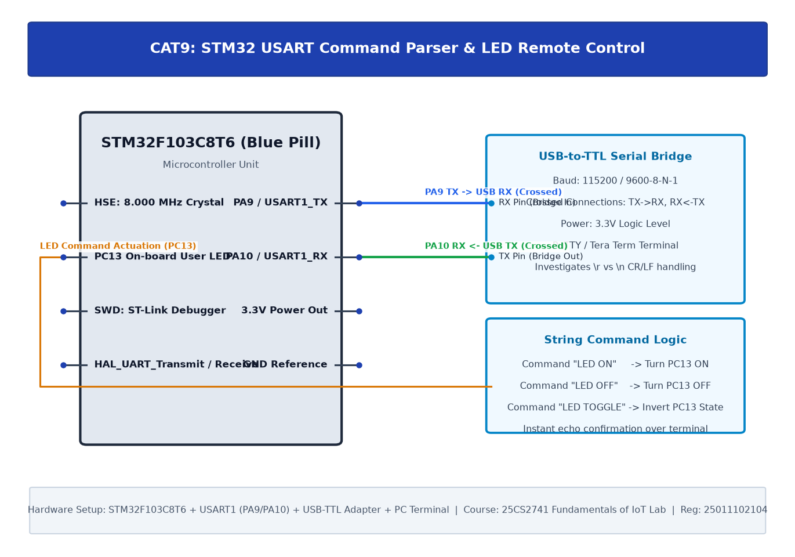

# TASK9A: STM32 UART Command Controlled LED

## Experiment Metadata

| Field | Description |
|---|---|
| **EXP** | CAT9 |
| **DATE** | 28/09/2026 |
| **NAME OF EXP** | STM32 UART Command Controlled LED |
| **HARDWARE SETUP / PLATFORM** | STM32F103C8T6, USART1 (PA9=TX, PA10=RX), CP2102 USB-to-UART Bridge, PuTTY Serial Terminal (115200-8N1) |
| **TASK NO** | TASK9A |

---

## Circuit Diagram



### Pin Connections & Hardware Interface

| STM32 Pin | Peripheral Connection | Function |
|---|---|---|
| PA9 | CP2102 RXD Pin | USART1 Asynchronous TX Output |
| PA10 | CP2102 TXD Pin | USART1 Asynchronous RX Input |
| GND | CP2102 GND | Common Ground Reference |

---

## Core Logic & Pseudocode

```text
1. Initialize HAL and configure System Clock to 72 MHz.
2. Configure USART1 peripheral: BaudRate=115200, WordLength=8B, StopBits=1, Parity=None, Mode=TX_RX.
3. Transmit welcome string banner using HAL_UART_Transmit().
4. In superloop:
   a. Transmit heartbeat string telemetry message every 2 seconds.
```

---

## Source Code Implementation

```c
#include "main.h"
#include <string.h>

UART_HandleTypeDef huart1;
void SystemClock_Config(void);
static void MX_GPIO_Init(void);
static void MX_USART1_UART_Init(void);

int main(void) {
    char msg[] = "STM32 USART1 Bring-Up Ready\r\n";
    HAL_Init();
    SystemClock_Config();
    MX_GPIO_Init();
    MX_USART1_UART_Init();

    HAL_UART_Transmit(&huart1, (uint8_t*)msg, strlen(msg), 100);

    while (1) {
        char telemetry[] = "[TELEMETRY] System Active\r\n";
        HAL_UART_Transmit(&huart1, (uint8_t*)telemetry, strlen(telemetry), 100);
        HAL_Delay(2000);
    }
}
```

---

## Inference & Technical Analysis

USART1 clock derived from APB2 peripheral clock (72 MHz max). Baud rate division register USART_BRR provides 115200 baud with less than 0.16% timing error, ensuring framing integrity.
