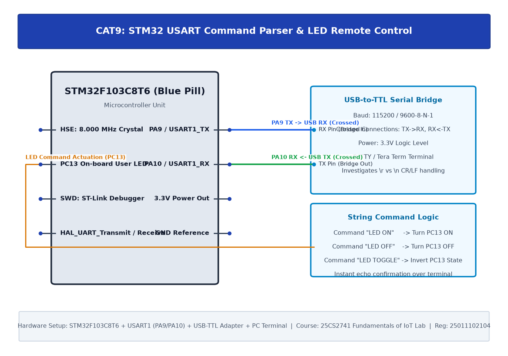

# TASK9B: STM32 UART Command Controlled LED

## Experiment Metadata

| Field | Description |
|---|---|
| **EXP** | CAT9 |
| **DATE** | 28/09/2026 |
| **NAME OF EXP** | STM32 UART Command Controlled LED |
| **HARDWARE SETUP / PLATFORM** | STM32F103C8T6, USART1 (PA9/PA10), USB-to-TTL Bridge, PC13 LED, PuTTY Serial Terminal |
| **TASK NO** | TASK9B |

---

## Circuit Diagram



### Pin Connections & Hardware Interface

| STM32 Pin | Peripheral Connection | Function |
|---|---|---|
| PA9, PA10 | CP2102 RXD, TXD | USART1 Serial Link |
| PC13 | On-board LED | Interactive Controlled Target |

---

## Core Logic & Pseudocode

```text
1. Initialize HAL, SystemClock, GPIO, and USART1 (115200-8N1).
2. Transmit menu: '1: ON, 0: OFF, T: TOGGLE'.
3. In superloop:
   a. Block/Poll for 1 received byte via HAL_UART_Receive(&huart1, &rx_byte, 1, HAL_MAX_DELAY).
   b. Switch(rx_byte):
      Case '1': Turn LED ON (PC13 LOW). Send confirmation.
      Case '0': Turn LED OFF (PC13 HIGH). Send confirmation.
      Case 'T'/'t': Toggle LED. Send confirmation.
      Default: Send 'Invalid Command' error message.
```

---

## Source Code Implementation

```c
#include "main.h"
#include <string.h>

UART_HandleTypeDef huart1;

int main(void) {
    uint8_t rx_data;
    char help[] = "Commands: 1=LED ON, 0=LED OFF, T=TOGGLE\r\n";
    HAL_Init();
    SystemClock_Config();
    MX_GPIO_Init();
    MX_USART1_UART_Init();

    HAL_UART_Transmit(&huart1, (uint8_t*)help, strlen(help), 100);

    while (1) {
        if (HAL_UART_Receive(&huart1, &rx_data, 1, 1000) == HAL_OK) {
            if (rx_data == '1') {
                HAL_GPIO_WritePin(GPIOC, GPIO_PIN_13, GPIO_PIN_RESET);
                HAL_UART_Transmit(&huart1, (uint8_t*)"LED: ON\r\n", 9, 50);
            } else if (rx_data == '0') {
                HAL_GPIO_WritePin(GPIOC, GPIO_PIN_13, GPIO_PIN_SET);
                HAL_UART_Transmit(&huart1, (uint8_t*)"LED: OFF\r\n", 10, 50);
            } else if (rx_data == 'T' || rx_data == 't') {
                HAL_GPIO_TogglePin(GPIOC, GPIO_PIN_13);
                HAL_UART_Transmit(&huart1, (uint8_t*)"LED: TOGGLED\r\n", 14, 50);
            }
        }
    }
}
```

---

## Inference & Technical Analysis

Character-based command state machine provides reliable embedded host telemetry control. Blocking timeout polling of 1000 ms avoids CPU freeze while ensuring zero frame loss during active terminal entry.
